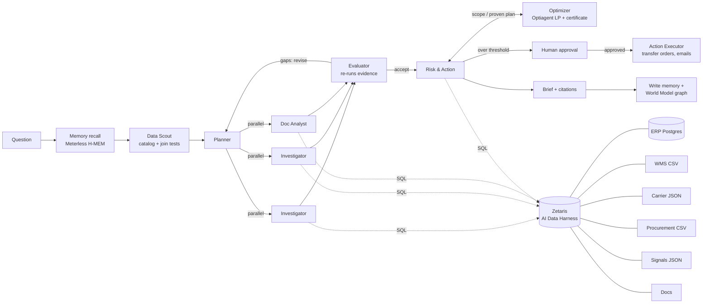

# WhyChain

**A team of AI agents that explains *why* a supply chain problem is happening, proves it with evidence from every system the company runs, and prescribes fixes that are *mathematically proven* to be the cheapest, ready for a manager to approve.**

Open Agent Hackathon 2026 · Track 2: *The Agent That Can Explain Why*

---

## The problem

**On real data.** In March 2018, 21.4% of orders on Olist, a Brazilian marketplace, arrived after the promised date, about double the usual rate. The order system shows that it happened, but not why. The evidence is spread across order timestamps, seller hand-over records, customer reviews and the news of the time. On the public Olist dataset (99,441 real orders), WhyChain's agents established in a few minutes:

- **Where the time went:** carrier-to-customer transit, not the sellers. Transit lengthened while sellers handed orders to the carrier slightly *faster* than in January–February.
- **Where it hit:** everywhere, but worst in Rio de Janeiro (34.5% late, against 16.8% in the rest of Brazil) and the Northeast. Rio alone accounts for about 2 of the 9 percentage points of the jump.
- **What the events can and can't explain:** the national Correios strike (12–13 Mar) is real but too small. Lateness was already high in the two weeks *before* it, and only 63 orders fell in the strike window. The agents said so rather than blaming the strike.
- **Ruled out with numbers:** order volume, product mix, new sellers, tighter delivery promises and data errors. They also caught a definition issue: comparing dates instead of timestamps changes the rate from 21.4% to 19.0%.

An independent SQL check on the raw data agrees: parcels handed to the carrier between 26 Feb and 18 Mar took about 15 days to arrive, against about 8.5 in a normal month, and Rio's transit doubled (9.7 → 20.7 days). What slowed the carrier nationally isn't in the data, and the brief lists that as an open question instead of guessing.

**In a simulated company,** where the agents can also act on stock: a planner sees that 26 of 32 Pune orders due next week are backordered. The answer to "why?" is spread across five systems and three inboxes:

- the **ERP** shows the backorders;
- the **warehouse export** shows the Pune DC running dry while Mumbai has surplus;
- the **procurement export** shows the supplier's revised ETA;
- the supplier's **email to procurement** explains the delay (a Chennai port strike);
- the **contract** says the strike is force majeure, so no penalty can be recovered;
- the key **customer's contract** says every late day costs 1.5% of order value.

A good analyst needs half a day to stitch that together. WhyChain does it in minutes, and shows its working.

## What it does

You ask a "why" question in plain English. WhyChain then:

1. **Maps the data.** The Data Scout reads the Zetaris catalog, profiles columns, proposes joins across sources and **tests every join against the data**. Joins that don't match are dropped. The map is saved to Meterless memory, so later runs skip this step.
2. **Plans competing hypotheses.** The Planner measures the symptom first, then sets up rival explanations (supply, inventory policy, demand, carrier, data quality, external events), including red herrings that need ruling out.
3. **Investigates in parallel.**
   - **Data Investigators** query all sources through **Zetaris** with federated SQL. They repair their own failed queries.
   - The **Document Analyst** searches contracts, policies and email, and must quote them **verbatim**. Quotes are checked character by character, and invented ones are thrown away.
4. **Challenges the findings.** The Evaluator **re-runs every cited query** to confirm the numbers reproduce. It then confirms, rejects or asks for more on each hypothesis, and checks whether the confirmed causes explain the *size* of the symptom. If not, it sends specific gaps back to the Planner, which plans another round.
5. **Turns causes into proven-optimal actions.** For any stock shortage, the Risk & Action agent calls the **optimizer**, built on Optiagent (see below). The agent chooses only the scope, for example "Voltix SKUs, to Pune, within 7 days". Code then reads the backorders, the spare stock at other DCs (after each keeps its policy cover), the truck lanes and the air-freight terms through Zetaris. It solves the transfer problem and returns a plan with a **duality certificate**: a proof that no cheaper plan exists. It also reports any units that can't arrive in time. The agent checks penalty exposure and policy, then proposes priced fixes. Anything over the approval threshold or under 60% confidence is **escalated to a human**.
6. **Does the approved work.** When a manager approves an action, the **Action Executor** prepares the deliverables that carry it out, grounded in the data:
   - stock-transfer orders (SKU by SKU, computed with SQL, never leaving the sending DC below its cover);
   - cancellation lists and parameter changes;
   - draft emails to suppliers, carriers and customers.

   Every table must come from one of the agent's own queries, which is re-run in full. Invented tables are discarded. Each deliverable can be downloaded (CSV / text).
7. **Reports and remembers.**
   - The Reporter writes a one-page brief in which every number cites its evidence. Citations to evidence that doesn't exist are removed.
   - Confirmed causes, ruled-out causes, lessons and the manager's approve/reject decisions are written to **Meterless H-MEM**.
   - The cause-and-effect links go into the **Meterless World Model**.



## Prescriptive layer: Optiagent (declared pre-existing component)

WhyChain doesn't estimate the fix by hand. It reuses the author's earlier project **[Optiagent](https://github.com/Dakshhhhh-ops/Optiagent)** (MIT, pinned to commit `f0b61d5`). Optiagent is a verified-optimization engine whose rule is that *the LLM never produces the numbers*. `whychain/optimize.py` is new work: it turns an agent's scope into a transportation problem built entirely from federated data.

| Part of the model | Where it comes from |
|---|---|
| Destinations | Backordered units per DC and SKU, due within the deadline (`erp.order_lines` + `erp.sales_orders`) |
| Sources | Spare stock per DC and SKU = on hand − allocated − policy cover (`wms.inventory_snapshots`, `wms.reorder_policy`) |
| Truck routes | Lane cost per unit and transit days (`wms.transfer_lanes`). Lanes too slow for the deadline are left out. |
| Air routes | Supplier air-freight surcharge and lead time (`procurement.expedite_options`) |
| Can't arrive in time | A unit with no route that meets the deadline costs its list price (lost sale), so the plan reports it instead of hiding it |

Optiagent builds the LP, solves it (OR-Tools GLOP), re-checks the plan against the original data and attaches a **duality certificate**. If the first solver's dual prices don't close the proof (it happens on degenerate problems), WhyChain re-runs Optiagent's own certificate with the second solver's (HiGHS) prices. If neither closes it, the plan is withheld rather than shown unproven. Lanes that would carry less than 15% of a truck are dropped and the problem is re-solved, because an LP doesn't model fixed truck costs. The Action Executor's transfer order *is* this proven plan, row for row.

## Sponsor technology

| Sponsor | How WhyChain uses it |
|---|---|
| **Zetaris** | The only path from agents to data. The Postgres ERP and the CSV/JSON file stores are registered once (`scripts/register_zetaris.py`). Agents then write one Spark SQL query that joins, say, `erp.sales_orders` with `carrier.shipments` and `procurement.purchase_orders`, with no data copied. The Scout discovers the data model from the Zetaris catalog, and every claim in the brief carries the exact Zetaris query behind it. |
| **Meterless** | `meterless_bridge/` runs the **real H-MEM and World Model reference engines** (Apache-2.0, unmodified, conformance suites green). H-MEM holds findings with provenance, and its consolidation promotes them to long-term memory, so the second investigation starts from the first one's conclusions. The World Model event-sources every agent step and builds a cause graph (e.g. `S-14 → implicated_in → late Voltix POs → causes → Pune backorders`). **Nightshift** serves the Document Analyst's model on the local GPU, so contracts and email never leave the machine. |
| **NVIDIA** | **NIM** serves **Nemotron 3.5 Super** (`nvidia/nemotron-3.5-super-vl-120b-a12b`) for every agent: with reasoning ("thinking") switched on for the Planner and Evaluator, and off, in JSON mode, for the agents that write SQL, read documents and write the brief. Nightshift can use the local **NVIDIA GPU (CUDA)**. |
| **Cursor** | Development environment for the build. *(Describe how you used it here.)* |
| **xAI Grok** | Optional first choice for the reasoning roles when a key is set. |

Every model call goes through one OpenAI-compatible client with role-based fallback:

| Role | Used by | Fallback order |
|---|---|---|
| `reason` | Planner, Evaluator | Grok → Nemotron (thinking) → Nemotron → Nightshift |
| `work` | Data Scout, Data Investigators, Risk & Action, Reporter, Action Executor | Nemotron → Grok → Nemotron (thinking) → Nightshift |
| `local` | Document Analyst | Nightshift → Nemotron → Ollama |

Transient errors (5xx, rate limits, timeouts) are retried with back-off before a call falls through to the next provider. The trace records every retry and fallback.

## Setup (clean machine)

Needs Python 3.11+, Node 20+, Docker.

```bash
# 1. Python environment
uv venv && uv pip install -e ".[dev]"          # or: python -m venv .venv && pip install -e ".[dev]"

# 2. Config
cp .env.example .env                             # then fill in keys (see comments in the file)

# 3. The data: order systems in Postgres, other systems as files
docker compose up -d
python -m datagen.olist                          # real Olist data: downloads the CSVs, writes data/olist/generated/, loads Postgres
python -m datagen.generate                       # simulated company: writes data/generated/
python -m datagen.load_postgres

# 4. Meterless engines bridge (separate terminal)
cd meterless_bridge && npm install && npm start  # http://localhost:8787

# 5. Zetaris: register the sources, then check them
python scripts/register_zetaris.py               # prints the SQL; --apply runs it via REST

# 6. Check everything
python -m whychain.doctor
```

With `WHYCHAIN_HARNESS=local`, the same sources and table names are served by DuckDB (ERP read live from Postgres). Agents write the same Spark SQL either way; it's translated with sqlglot. This exists for offline development and as a fallback if Zetaris is unreachable during a demo. The UI always shows which harness answered.

## Usage

```bash
# Web app: build the frontend once, then serve API + UI together
cd frontend && npm install && npm run build && cd ..
python -m whychain.api                           # http://localhost:8000

# Frontend development with hot reload (proxies /api to :8000)
cd frontend && npm run dev                       # http://localhost:5173

python -m whychain.cli "Why have deliveries to Nashik been late since September?"
python -m evals.run_evals                        # score all planted scenarios
python -m pytest -q tests                        # wiring test (no API keys needed)
```

### The app

| Screen | What it shows |
|---|---|
| **Control tower** | Live KPIs (on-time rate, orders due, value at risk, late inbound) and a **Needs attention** list. Generic rules running SQL through the data harness find lanes whose on-time rate fell, DCs with backordered orders, categories running short, late suppliers and disrupted ports. Each item has an **Investigate why** button. Below is a supply network map (suppliers → entry ports → DCs → customer cities), coloured by live status. |
| **Investigation (live)** | Agents stream their work as it happens (Server-Sent Events). A stage tracker runs Recall → Map data → Plan → Investigate → Challenge → Act → Report. The hypothesis board updates as findings and verdicts arrive, including the Evaluator's send-backs, and the activity feed shows every query, document read, re-verification and escalation. |
| **Brief** | The answer, with every number citing clickable evidence; recommended actions with cost and approve/reject (decisions are written to Meterless memory); risks; lessons saved. Export to Markdown or print to PDF. |
| **Deliverables** | After approval, the Action Executor's output appears on the action card: transfer orders, cancellation lists and draft emails, each downloadable. |
| **Network** | The supply network with the confirmed cause's path lit up, e.g. Voltix → Chennai port → Pune DC. |
| **Evidence** | Every SQL result (query, rows, re-verification badge) and every document quote (verified word for word). |
| **Memory & graph** | What was recalled from earlier runs, the cause graph in the Meterless World Model, and the data map's verified joins. |
| **Trace** | Every event, filterable by agent, downloadable as JSONL. Any finished run can be replayed. |
| **Memory** | Everything WhyChain has learned across runs, by tier (Meterless H-MEM). |
| **Data sources** | The six federated sources, their tables and columns, and the joins the Data Scout verified. |

Every run writes `runs/<run_id>/`:
- `trace.jsonl`: every agent step, SQL query, model call, fallback, verdict and escalation.
- `result.json`: plan, findings, evidence, verdicts and actions.
- `brief.md`: the action brief.

## The data

WhyChain ships with two datasets. The sidebar switches between them; the agents, prompts and UI are the same for both.

### 1. Olist: real Brazilian e-commerce data (default)

The [Brazilian E-Commerce Public Dataset by Olist](https://www.kaggle.com/datasets/olistbr/brazilian-ecommerce) (CC BY-NC-SA 4.0): 99,441 real, anonymised orders placed from 2016 to 2018. `python -m datagen.olist` downloads the original CSVs and splits them into the systems a marketplace would actually run, so the agents have to federate:

| Source | System | Tables |
|---|---|---|
| `oms` | Order management (Postgres) | `orders` (purchase, approval, carrier hand-over, delivery and promised dates), `customers` |
| `sellers` | Seller platform (CSV) | `order_items` (with each seller's shipping deadline), `sellers`, `products` |
| `payments` | Payment gateway (JSON lines) | `order_payments` |
| `feedback` | Customer reviews (JSON lines) | `reviews`: 100,000 real reviews, in Portuguese |
| `signals` | External events (JSON lines) | `events`: 16 verified events, 2017–2018 |
| `docs` | News briefs | `documents`: 13 briefs on those events |

Nothing is planted. The events (Correios strikes, the 2018 truckers' strike, Carnival, Black Friday, Rio de Janeiro's federal intervention and cargo-theft record, Correios price and policy changes) were researched for this project from public sources, mainly Agência Brasil and the official legal texts. Every event and brief lists its source URLs, and the control tower links to them. They are in `datagen/olist_events.json`, with summaries paraphrased rather than copied. The dataset is not redistributed in this repository; the script downloads it.

The control tower finds incidents with plain rules on the real data: months whose late-delivery rate is far above the median, months where sellers missed hand-over deadlines, falls in review scores, reviews that mention strikes, and states with chronic delays. Verified events are marked on the monthly chart.

### 2. Kaveri: a simulated distributor, for the full prescriptive loop

Olist has no warehouse stock to move, so the optimizer and stock-transfer deliverables are shown on a simulated company. It is fictional: **Kaveri Consumer Electronics Distribution**, with 3 DCs (Mumbai, Pune, Chennai), 11 suppliers, 74 SKUs and 52 retail customers. `datagen/generate.py` simulates 90 days of the business day by day: orders, ship-complete fulfilment, reorder-point replenishment, supplier lead times and carrier transit. Problems are planted as **causes**, not answers:

| Case | Planted cause | Red herring |
|---|---|---|
| A. Pune orders at risk | Chennai port strike strands Voltix (S-14) pre-build POs; Mumbai holds surplus | IMD rain alert in Pune |
| B. Nashik deliveries late | SwiftCargo's v2 contract moved the lane to a Tue/Fri consolidated milk-run | stock-outs |
| C. Mumbai earbuds stock-out | Marketing's DIWALI26 promo was never shared with planning; reorder points stale | port strike |
| D. Chennai backlog jump | EDI connector v3.2 retry bug duplicates orders (same `external_ref`) | thunderstorms |
| E. On-time rate drop | Several of the above at once | weather |

`evals/cases.yaml` holds the ground truth. The agents never see it.

## Results

Run `python -m evals.run_evals` to regenerate `evals/results.md`.

<!-- RESULTS -->
*(results table goes here after the first full evaluation run)*

## Reliability

| Safeguard | What it prevents |
|---|---|
| Read-only SQL guard (one `SELECT` / `WITH` / `SHOW` / `DESCRIBE`) | Agents changing data |
| SQL self-repair loop | Failed queries stopping a task |
| Evidence re-execution | Numbers that don't reproduce |
| Verbatim quote verification | Invented quotes |
| Citation filter | Citations to evidence that doesn't exist |
| Join tests | Bad joins in the data map |
| Model fallback chain | One provider failing the whole run |
| Local harness fallback | Zetaris being unreachable during a demo |
| Bounded rounds (`WHYCHAIN_MAX_ROUNDS`) | Endless revise loops |
| Deterministic escalation thresholds | Expensive actions going ahead without a human |

## Repository layout

```
whychain/          agents, graph (LangGraph), harness (Zetaris + local), LLM client, memory, trace, CLI
  agents/          prompts.py, executor.py (act-observe loop), nodes.py (each agent)
  api.py           FastAPI server: runs, live event stream (SSE), decisions, overview, memory, sources
  overview.py      control-tower KPIs, problem detection rules, supply network
  optimize.py      prescriptive layer: data → transportation LP → Optiagent (proven-optimal plan)
frontend/          React + TypeScript + Tailwind web app (Vite)
datagen/           company simulator, documents, Postgres loader
evals/             ground-truth cases and scorer
meterless_bridge/  Node service exposing Meterless H-MEM + World Model engines over HTTP
scripts/           Zetaris source registration
tests/             end-to-end wiring test with a scripted model
```

## Pre-existing components

- `optiagent-core` (installed from `github.com/Dakshhhhh-ops/Optiagent`, commit `f0b61d5`, MIT): the author's earlier verified-optimization engine (LP builder, solver, plan checks, duality certificate, sensitivity analysis). Built before the hackathon and used unmodified as a library. The integration (`whychain/optimize.py`, the `optimize` agent action, the UI) is new.
- `meterless_bridge/engines/`: Meterless H-MEM and World Model reference engines, copied unmodified from `Meterless/Meterless` @ `1742dec` (Apache-2.0, LICENSE files included).
- Open-source libraries listed in `pyproject.toml` and `meterless_bridge/package.json`.
- The Olist dataset is third-party public data (CC BY-NC-SA 4.0), downloaded by `datagen/olist.py` and not included in the repository.
- The project scaffold, data generator and first version of the agent pipeline were written on 21 Oct 2026, before the build window opened, and are declared here and on the submission form.
