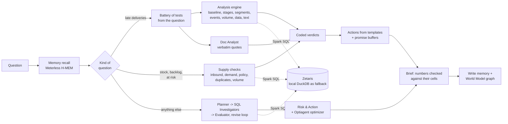

# WhyChain

**A team of AI agents that explains *why* a supply chain problem is happening, proves it with evidence from every system the company runs, and prescribes fixes that are *mathematically proven* to be the cheapest, ready for a manager to approve.**

Open Agent Hackathon 2026 · Track 2: *The Agent That Can Explain Why*

---

## The problem

**On real data.** In March 2018, 19.0% of orders on Olist, a Brazilian marketplace, arrived after the promised date, against about 4–6% in a normal month. The order system shows that it happened, but not why. The evidence is spread across order timestamps, seller hand-over records, customer reviews and the news of the time.

What the raw data shows, checked independently with SQL (not by the agents):
- **Transit:** carrier transit was about 13 days in February–March 2018, against about 8.5 in a normal month. Hand-over by sellers did not slow.
- **Rio de Janeiro:** worst hit. Transit doubled (9.7 → 20.7 days) and late deliveries rose from 6% to 34%, against 16.8% in the rest of Brazil.
- **The 12–13 March Correios strike:** lateness was already high before it.

What the agents concluded in the four saved runs of this question since the baseline fix, before the latest fixes:
- **Every run:** carrier transit is the main cause (50–85% of the jump); seller hand-over, order volume and mix, and data errors are ruled out.
- **Inconsistent:** every run *also* confirmed "the Correios strike / Rio disruption" as a partial cause (12–40%), and one headline put the strike first. The Rio part is supported by the data; the strike part is not. The planner bundled both into one hypothesis, and the Evaluator confirmed it as a whole.
- **The first run of all** (before the baseline fix) blamed tighter delivery promises. That was wrong: its Jan–Feb baseline was itself abnormal.

These runs used a timestamp definition of "late" in some steps (21.4%) and calendar dates in others (19.0%). There is now one definition: calendar dates, because the promised date has no time of day. The Evaluator now judges bundled hypotheses part by part and rejects events that start after their effect. New runs and their results are in "Results"; what is still weak is in "Known limitations".

**In a simulated company,** where the agents can also act on stock: a planner sees that 26 of 32 Pune orders due next week are backordered. The answer to "why?" is spread across five systems and three inboxes:

- the **ERP** shows the backorders;
- the **warehouse export** shows the Pune DC running dry while Mumbai has surplus;
- the **procurement export** shows the supplier's revised ETA;
- the supplier's **email to procurement** explains the delay (a Chennai port strike);
- the **contract** says the strike is force majeure, so no penalty can be recovered;
- the key **customer's contract** says every late day costs 1.5% of order value.

A good analyst needs half a day to stitch that together. WhyChain does it in minutes, and shows its working.

## How it works

WhyChain splits the work between **code that computes** and **agents that plan, read and write**. Numbers and verdicts come from code; language models never produce a number that reaches the brief.

**Questions about late deliveries** (the real Olist data, and lateness questions on the simulated company) run on the **analysis engine** (`whychain/analysis/`):

1. **One federated query** pulls order-level facts through the data harness. That's one row per order: purchase, hand-over to the carrier, delivery, promised date, place, seller, carrier. "Late" has one definition: delivered on a later calendar date than promised.
2. **The question becomes a fixed battery of tests** (`battery.py`). The period, places and named events are read from the question with plain rules. The same kind of question always gets the same tests:
   - **the symptom** against a *normal* baseline: the months (or weeks) before, minus any that were themselves abnormal;
   - **each delivery stage** (seller hand-over, carrier transit, the promise): counterfactual late rates where a stage takes its baseline distribution, matched like with like by area. Exact **Shapley values** split the rise, so the shares add up;
   - **waiting for stock** (datasets with stock data): were the slow hand-overs orders waiting for stock the warehouse didn't have on their requested ship date? A counterfactual gives the hand-over without those waits, and the short lines name the suppliers and any promotion behind their demand. This explains the dispatch stage rather than counting as another cause, and changes its action from "enforce hand-over deadlines" to "clear the stock-outs";
   - **where it sits**: a shift-share split of the rise by area, seller state or carrier, separating "it got worse there" from "more orders came from there";
   - **volume**: orders per day against the four weeks before (business growth is not a surge);
   - **dated events** in or near the period: weekly transit and lateness, by the week parcels were handed to the carrier, against the **prior trend**. An event counts only if the change starts with it, and for a regional event, only if it is larger in that region;
   - **data quality and definitions**, and **what customers wrote** (review mentions per thousand orders);
   - for regional questions, a second comparison with **places at a similar distance** (similar promised times), to separate distance from everything else.
3. **Coded verdicts.** A stage is a cause if it explains at least 10% of the rise **and** the stage itself moved the late way: its average by a quarter day or more, or its typical (median) or four-in-five (80th percentile) time by a day or more (for promises: shorter). The second condition was added after held-out case KH2: on 98 orders, transit that hadn't changed (typically 2.0 against 2.0 days) picked up 14.6% of the rise from noise in the counterfactual. An event is a cause only if the effect starts with it. Volume counts only if orders rose 25% or more and the chain slowed with it. The thresholds are in the code and the brief.
4. **Agents** around the engine:
   - the **Document Analyst** reads the written record and must quote it verbatim. Documents are context, never a cause: dated events are judged by the event test;
   - **actions** come from templates per confirmed cause, sized with computed tables (e.g. the promise buffer each state needs);
   - a model writes only the brief's short answer, from the computed facts. Every number in the brief is checked against its cells and marked "(unverified)" if it isn't there.

A late-delivery investigation takes 5 to 9 model calls and 25 s to about 2 minutes on the local harness (1.5 to 4 minutes through Zetaris), and gives the same numbers on every run.

**Stock-outs, backlogs and orders at risk** (the simulated company) run on the **supply engine** (`whychain/analysis/supply.py`), built the same way. The warehouse, product category and time window come from the question, and the same checks always run on order lines, stock, purchase orders and the external signals:
- **inbound supply**: purchase orders overdue against their expected date, by supplier and port of entry, set against the port status feed;
- **demand**: units ordered against the reorder baseline, naming the promotions behind a spike;
- **reorder policy**: reorder points below what current demand needs, and when they were last reviewed;
- **duplicate orders**: orders repeated under the same external reference, judged by the units the extra copies order (they are counted once in every other check);
- **order volume** against the weeks before.

A check is a cause when it is involved in at least 25% of the short units. The shares overlap (one SKU can be both late inbound and under a stale reorder point), and a disrupted port is reported as the reason purchase orders are late, not as a separate cause. Actions come from the same numbers: the Optiagent stock-transfer plan, which purchase orders to chase, which reorder points to raise, which duplicates to cancel.

**Any other question** uses the **agent loop**:
- the Data Scout maps and join-tests the sources;
- the Planner sets competing hypotheses;
- Data Investigators write SQL;
- the Evaluator re-runs every cited query and challenges the reasoning, sending gaps back for another round;
- the Risk & Action agent calls the **Optiagent optimizer** for stock transfers, with a duality certificate proving no cheaper plan exists;
- the **Action Executor** prepares transfer orders, cancellation lists and draft emails after a manager approves.

The same numbers check applies to findings, actions and the brief.

Both paths write confirmed and ruled-out causes, with their provenance, to **Meterless H-MEM**, and cause-effect links to the **Meterless World Model**.



## Prescriptive layer: Optiagent (declared pre-existing component)

WhyChain doesn't estimate the fix by hand. It reuses the author's earlier project **[Optiagent](https://github.com/Dakshhhhh-ops/Optiagent)** (MIT, pinned to commit `f0b61d5`). Optiagent is a verified-optimization engine whose rule is that *the LLM never produces the numbers*. `whychain/optimize.py` was written for WhyChain (before the build window, see "Pre-existing work"): it turns an agent's scope into a transportation problem built entirely from the data. The optimizer applies only to the simulated dataset, which has stock, lanes and freight costs; the real Olist data has no cost data, so its actions carry no computed costs (see "Known limitations").

| Part of the model | Where it comes from |
|---|---|
| Destinations | Backordered units per DC and SKU, due within the deadline (`erp.order_lines` + `erp.sales_orders`) |
| Sources | Spare stock per DC and SKU = on hand − allocated − policy cover (`wms.inventory_snapshots`, `wms.reorder_policy`) |
| Truck routes | Lane cost per unit and transit days (`wms.transfer_lanes`). Lanes too slow for the deadline are left out. |
| Air routes | Supplier air-freight surcharge and lead time (`procurement.expedite_options`) |
| Can't arrive in time | A unit with no route that meets the deadline costs its list price (lost sale), so the plan reports it instead of hiding it |

Optiagent builds the LP, solves it (OR-Tools GLOP), re-checks the plan against the original data and attaches a **duality certificate**. If the first solver's dual prices don't close the proof (it happens on degenerate problems), WhyChain re-runs Optiagent's own certificate with the second solver's (HiGHS) prices. If neither closes it, the plan is withheld rather than shown unproven. Lanes that would carry less than 15% of a truck are dropped and the problem is re-solved, because an LP doesn't model fixed truck costs. The Action Executor's transfer order *is* this proven plan, row for row.

## Sponsor technology: designed role and actual status

This table separates what the code is built to do from what has actually run. Runs before 22 Oct 18:03 IST used the local DuckDB harness; runs since then go through the **local Zetaris platform**. Every model call so far has gone to **NVIDIA NIM**.

| Sponsor | Designed role | Status today |
|---|---|---|
| **Zetaris** | The single path from agents to data. Sources are registered once (`scripts/register_zetaris.py`), and agents write federated Spark SQL across them. | **Connected: the local Zetaris platform (the hackathon Docker bundle).** Both datasets are registered: the order systems through a Postgres JDBC datasource, the exports as Lightning file tables read in place (26 tables, every row count matching). The engine's fact query, the agents' SQL, the catalog the Data Scout maps and the dashboard all go through it. Not used: Zetaris Cloud (the client has a cloud mode, untested). DuckDB remains as the fallback. |
| **Meterless** | H-MEM memory with provenance and the World Model cause graph, via `meterless_bridge/`, which runs the reference engines as libraries. H-MEM's recall uses **NVIDIA Nemotron embeddings** (`nvidia/nemotron-3-embed-1b`) in place of its reference mock embedder. Nightshift would serve the Document Analyst's model locally. | **H-MEM and World Model: used in every run.** Nemotron embeddings since 22 Oct 19:21 IST (earlier runs used the reference hash mock, so similarity recall was weak); WhyChain still filters recalled findings by question similarity. Exactly one vendored file changed: a provider hook in H-MEM's `embeddings.ts` (see "Pre-existing work"); H-MEM conformance passes 13/13 with the provider off and on. In a recall test with reworded questions (`scripts/recall_demo.py`), the right finding came first for 5 of 6 questions with Nemotron, 2 of 6 with the mock. **Nightshift: not installed.** The Document Analyst currently runs on NVIDIA's cloud, so documents *are* sent to NIM. |
| **NVIDIA** | NIM serves **Nemotron 3.5 Super** (`nvidia/nemotron-3.5-super-vl-120b-a12b`). Reasoning ("thinking") is on for the Planner and Evaluator, and off, in JSON mode, for the other agents. **Nemotron 3 Ultra** (`nvidia/nemotron-3-ultra-550b-a55b`) is the backup model. **Nemotron 3 Embed** (`nvidia/nemotron-3-embed-1b`) embeds every memory and recall query for Meterless H-MEM. | **Used in every run** (cloud NIM). Local GPU use via Nightshift is not set up. |
| **xAI Grok** | Optional first choice for the reasoning roles. | **Not configured;** no run has used it. |

Every model call goes through one OpenAI-compatible client with role-based fallback. Providers that aren't configured are skipped, so **with today's configuration every chain runs entirely on NVIDIA's NIM endpoint**: Nemotron 3.5 Super, then a different model, Nemotron 3 Ultra. That covers one model being overloaded, which is the usual NIM failure, but not an outage of the NIM endpoint itself. Grok or Nightshift would make the chain independent.

| Role | Used by | Order (configured today in bold) |
|---|---|---|
| `reason` | Planner, Evaluator | Grok → **Nemotron 3.5 (thinking)** → **Nemotron 3 Ultra** → **Nemotron 3.5** → Nightshift |
| `work` | Data Scout, Data Investigators, Risk & Action, Reporter, Action Executor | **Nemotron 3.5** → **Nemotron 3 Ultra** → Grok → **Nemotron 3.5 (thinking)** → Nightshift |
| `local` | Document Analyst | Nightshift → **Nemotron 3.5** → **Nemotron 3 Ultra** → Ollama |

Transient errors (5xx, rate limits, timeouts) are retried with back-off: twice when another provider follows, four times on the last one. The trace records every retry and fallback.

## How the sponsor technologies are used (submission requirement)

The Official Rules (section 6) ask for a clear explanation of four things. In brief:

**How Zetaris is integrated.** Zetaris is the only path from WhyChain to company data. The local Zetaris platform (the hackathon's Docker bundle) federates six source systems per dataset: the order systems through a Postgres JDBC datasource, and the CSV and JSON exports as Lightning file tables read in place, so nothing is copied into a warehouse or a vector store. `scripts/register_zetaris.py` registers them and checks every table's row count against the source (26 tables, all matching). Everything queries through it: the analysis engine's order-level fact query, which joins the Postgres order system with the seller export (five tables) in one statement; the agents' own Spark SQL; the catalog the Data Scout maps; and the dashboard. Every run records `harness: zetaris`, and every cited result can be re-run through it.

**How Meterless is integrated.** `meterless_bridge/` runs the Meterless reference engines as libraries behind a small HTTP service. **H-MEM** stores every confirmed and ruled-out finding with provenance (run, agent, query or document), and each new investigation recalls related past findings as hints, never as evidence. The **World Model** stores the cause-effect relations each run confirms, as a cause graph across runs. H-MEM's recall uses NVIDIA Nemotron embeddings in place of its reference mock embedder: exactly one vendored file changed, to add a provider hook (see "Pre-existing work"). Conformance passes with the provider off and on.

**How Cursor was used during development.** [FOR THE AUTHOR: how Cursor was used during development]

**Where NVIDIA technology contributes.** Every language-model call runs on Nemotron through NVIDIA NIM: Nemotron 3.5 Super for the agents (document reading with verified quotes, the brief's short answer, and the agent loop's planning, SQL and evaluation, with reasoning on for planning and judging), and Nemotron 3 Ultra as the fallback when 3.5 Super is overloaded. Nemotron 3 Embed (`nvidia/nemotron-3-embed-1b`) embeds every memory and recall query for Meterless H-MEM. See "How WhyChain uses NVIDIA Nemotron".

**What is unique about this use.** The sponsor technologies sit where they carry weight, not decoration:
- Zetaris carries the one federated query that every computed number traces back to, so a judge can click any figure in a brief, see its SQL and re-run it through Zetaris.
- Meterless memory is reused only under rules (a similar question, never as evidence), and its recall runs on Nemotron embeddings: a reworded question finds the right past finding 5 times in 6, against 2 in 6 with the mock (`scripts/recall_demo.py`).
- Nemotron reads, plans, quotes and writes, but never produces a number or a verdict: those come from code and are checked against their cells. That design cut model calls per real-data question from 50 to 70 down to 5 to 9, and made the answers reproducible run to run.

## Setup (clean machine)

Needs Python 3.11+, Node 20+, Docker.

```bash
# 1. Python environment
uv venv && uv pip install -e ".[dev]"          # or: python -m venv .venv && pip install -e ".[dev]"

# 2. Config
cp .env.example .env                             # then fill in keys (see comments in the file)

# 3. The data: order systems in Postgres, other systems as files
docker compose up -d
python -m datagen.olist                          # real Olist data: downloads the CSVs, writes data/olist/generated/, loads Postgres
python -m datagen.generate                       # simulated company: writes data/generated/
python -m datagen.load_postgres

# 4. Meterless engines bridge (separate terminal)
cd meterless_bridge && npm install && npm start  # http://localhost:8787

# 5. Zetaris (the hackathon's local platform bundle, in its own folder):
#    copy docs/zetaris-override.yml there as docker-compose.override.yml (it mounts WhyChain's data),
#    set WHYCHAIN_DIR, docker compose up -d; put the admin login in WhyChain's .env (ZETARIS_USER/PASSWORD)
python scripts/register_zetaris.py               # registers both datasets, then checks every table's row count

# 6. Check everything
python -m whychain.doctor
```

With `WHYCHAIN_HARNESS=zetaris`, every query goes to Zetaris: Postgres through a JDBC datasource, the CSV and JSON exports as Lightning file tables read in place. With `WHYCHAIN_HARNESS=local` (or if Zetaris is unreachable), the same sources and table names are served by DuckDB, with the ERP read live from Postgres. Agents write the same Spark SQL either way; for DuckDB it's translated with sqlglot. The UI always shows which harness answered.

How the two compare (`scripts/register_zetaris.py` and the checks behind this commit): every table has the same row count; the computed findings for all 11 eval questions are identical; agent-style queries (cross-source joins, date arithmetic) return the same rows. Zetaris takes 0.2 to 1.3 s per query where DuckDB takes milliseconds, and the first fact load of a session about 17 s instead of 8 s.

## Usage

```bash
# Web app: build the frontend once, then serve API + UI together
cd frontend && npm install && npm run build && cd ..
python -m whychain.api                           # http://localhost:8000

# Frontend development with hot reload (proxies /api to :8000)
cd frontend && npm run dev                       # http://localhost:5173

python -m whychain.cli "Why did late deliveries jump to 21% for orders placed in March 2018?"
python -m whychain.cli --dataset kaveri "Why have deliveries to Nashik been late since September?"
python -m evals.run_evals --dataset olist        # score the real-data cases (or --dataset kaveri, or all)
python -m pytest -q tests                        # wiring test (no API keys needed)
```

### The app

| Screen | What it shows |
|---|---|
| **Control tower** | On real data: a monthly chart of orders and late deliveries, with **verified external events** marked on it (hover one to read it, with links to its sources), KPI cards, and **incidents found in the data** by plain SQL rules (late-delivery spikes, missed seller hand-overs, review-score dips, reviews mentioning strikes, chronically late states). Each incident has an **Investigate why** button. On the simulated company: live KPIs, a **Needs attention** list (lanes whose on-time rate fell, backordered DCs, late suppliers, disrupted ports) and a supply network map coloured by live status. |
| **Investigation (live)** | Agents stream their work as it happens (Server-Sent Events). A stage tracker runs Recall → Map data → Plan → Investigate → Challenge → Act → Report. The hypothesis board updates as findings and verdicts arrive, including the Evaluator's send-backs, and the activity feed shows every query, document read, re-verification and escalation. |
| **Brief** | The answer, with every number citing clickable evidence; recommended actions with cost and approve/reject (decisions are written to Meterless memory); risks; lessons saved. Export to Markdown or print to PDF. |
| **Deliverables** | After approval, the Action Executor's output appears on the action card: transfer orders, cancellation lists and draft emails, each downloadable. |
| **Regions** (real data) | A tile map of Brazil's 27 states. It shows how much each state's late-delivery rate rose in the month the question is about, against a normal baseline (the six months before, leaving out months that were abnormal nationally), and outlines the states named in the confirmed causes. Hover a state for its late rate and carrier transit time. |
| **Network** (simulated company) | The supply network with the confirmed cause's path lit up, e.g. Voltix → Chennai port → Pune DC. |
| **Evidence** | Every SQL result (query, rows, re-verification badge) and every document quote (verified word for word). |
| **Memory & graph** | What was recalled from earlier runs, the cause graph in the Meterless World Model, and the data map's verified joins. |
| **Trace** | Every event, filterable by agent, downloadable as JSONL. Any finished run can be replayed. |
| **Memory** | Everything WhyChain has learned across runs, by tier (Meterless H-MEM). |
| **Data sources** | The six federated sources, their tables and columns, and the joins the Data Scout verified. |

Every run writes `runs/<run_id>/`:
- `trace.jsonl`: every agent step, SQL query, model call, fallback, verdict and escalation.
- `result.json`: plan, findings, evidence, verdicts and actions.
- `brief.md`: the action brief.

## The data

WhyChain ships with two datasets. The sidebar switches between them; the agents, prompts and UI are the same for both.

### 1. Olist: real Brazilian e-commerce data (default)

The [Brazilian E-Commerce Public Dataset by Olist](https://www.kaggle.com/datasets/olistbr/brazilian-ecommerce) (CC BY-NC-SA 4.0): 99,441 real, anonymised orders placed from 2016 to 2018. `python -m datagen.olist` downloads the original CSVs and splits them into the systems a marketplace would actually run, so the agents have to federate:

| Source | System | Tables |
|---|---|---|
| `oms` | Order management (Postgres) | `orders` (purchase, approval, carrier hand-over, delivery and promised dates), `customers` |
| `sellers` | Seller platform (CSV) | `order_items` (with each seller's shipping deadline), `sellers`, `products` |
| `payments` | Payment gateway (JSON) | `order_payments` |
| `feedback` | Customer reviews (JSON) | `reviews`: 100,000 real reviews, in Portuguese |
| `signals` | External events (JSON) | `events`: 16 verified events, 2017–2018 |
| `docs` | News briefs | `documents`: 13 briefs on those events |

Nothing is planted. The events (Correios strikes, the 2018 truckers' strike, Carnival, Black Friday, Rio de Janeiro's federal intervention and cargo-theft record, Correios price and policy changes) were researched for this project from public sources, mainly Agência Brasil and the official legal texts. Every event and brief lists its source URLs, and the control tower links to them. They are in `datagen/olist_events.json`, with summaries paraphrased rather than copied. The dataset is not redistributed in this repository; the script downloads it.

The control tower finds incidents with plain rules on the real data: months whose late-delivery rate is far above the median, months where sellers missed hand-over deadlines, falls in review scores, reviews that mention strikes, and states with chronic delays. Verified events are marked on the monthly chart.

### 2. Kaveri: a simulated distributor, for the full prescriptive loop

Olist has no warehouse stock to move, so the optimizer and stock-transfer deliverables are shown on a simulated company. It is fictional: **Kaveri Consumer Electronics Distribution**, with 3 DCs (Mumbai, Pune, Chennai), 11 suppliers, 74 SKUs and 52 retail customers. `datagen/generate.py` simulates 90 days of the business day by day: orders, ship-complete fulfilment, reorder-point replenishment, supplier lead times and carrier transit. Problems are planted as **causes**, not answers:

| Case | Planted cause | Red herring |
|---|---|---|
| A. Pune orders at risk | Chennai port strike strands Voltix (S-14) pre-build POs; Mumbai holds surplus | IMD rain alert in Pune |
| B. Nashik deliveries late | SwiftCargo's v2 contract moved the lane to a Tue/Fri consolidated milk-run | stock-outs |
| C. Mumbai earbuds stock-out | Marketing's DIWALI26 promo was never shared with planning; reorder points stale | port strike |
| D. Chennai backlog jump | EDI connector v3.2 retry bug duplicates orders (same `external_ref`) | thunderstorms |
| E. On-time rate drop | Several of the above at once | weather |

`evals/cases.yaml` holds the ground truth. The agents never see it.

## Results

Run `python -m evals.run_evals` (or `--dataset olist|kaveri`) to regenerate `evals/results.md`. A case passes "root cause found" when the expected terms appear, as whole words, in a cause the Evaluator confirmed or in the headline. Keyword scoring is crude; read the briefs too.

<!-- RESULTS -->
### Real data (Olist), analysis-engine architecture: two independent passes, 22 Oct 16:10 to 16:25 IST

Each pass ran all six questions on an empty memory, one after the other (`evals/run_evals.py --dataset olist`). O1 to O3 are development cases; H1 to H3 are held out (added after the last prompt change, ground truth computed with SQL before any agent ran them).

| Case | | Pass 1 | Pass 2 | Model calls | Time | What the brief says |
|---|---|---|---|---|---|---|
| O1 March 2018 spike | dev | ✅ 2/2, no red herring | ✅ 2/2, no red herring | 7 / 6 | 52 s / 55 s | 19.0% late vs a normal 5.6%. Carrier transit 72.7% and shorter promises 26.7% of the rise; concentrated in RJ. Strike, Carnival, Rio storm, volume and data errors ruled out. |
| O2 Black Friday 2017 | dev | ✅ 2/2, no red herring | ✅ 2/2, no red herring | 7 / 6 | 77 s / 25 s | Yes: the effect starts with Black Friday. Volume about 2.9x the weeks before, and transit slowed with it. |
| O3 Truckers' strike 2018 | dev | ✅ 2/2, no red herring | ✅ 2/2, no red herring | 7 / 6 | 48 s / 111 s | Yes: transit rose against the prior trend for parcels handed over during the strike (the old architecture said "no measurable delay"). |
| H1 Carnival 2018 | held out | ✅ 1/1, no red herring | ✅ 1/1, no red herring | 5 / 6 | 68 s / 29 s | No: transit was already raised before Carnival and didn't jump with it. |
| H2 Northeast delays | held out | ✅ 2/2, no red herring | ✅ 2/2, no red herring | 9 / 9 | 90 s / 123 s | Carrier transit is twice as long (median 14 vs 7 days); almost all orders ship from another state; longer promises offset most of it. |
| H3 Rio security | held out | ✅ 2/2 (no red herring defined) | ✅ 2/2 | 6 / 7 | 44 s / 140 s | RJ is late more often than states at a similar distance, and transit explains it; the data can't prove theft is the cause. |

- **Reproducibility:** across the two passes, **all 62 computed findings were identical** (verdict, cause share and claim), and so were all six headlines. Only the Document Analyst's reading and the short model-written answer vary.
- **Models used:** Nemotron 3.5 Super, with Nemotron 3 Ultra taking over when NVIDIA rate-limited it (column "Models used" in `evals/results.md`). The computed findings don't depend on which model answered.
- **Scorer change, disclosed:** pass 1 was first scored with the earlier scorer, which counted only confirmed *causes*. O1 and H2 then scored 1/2, because "where the rise sits" (RJ / interstate shipping) is reported as a measurement. The scorer now also counts confirmed measurements; red herrings are still judged on causes only. The table uses the current scorer for both passes.
- **Earlier architecture, for comparison:** 8 to 10 minutes and 50 to 70 model calls per question. The strike verdict on O1 flipped between runs, and O3 was answered wrongly.
- Both passes above used the local DuckDB harness. The third pass, below, ran through Zetaris.

### Real data (Olist) through Zetaris: third pass, 22 Oct 18:03 to 18:19 IST

The same six questions and the same code, with `WHYCHAIN_HARNESS=zetaris`: every query, including the engine's fact query, went to the local Zetaris platform (`harness: zetaris` in each run's `result.json`), on an empty memory.

| Case | | Result | Model calls | Time |
|---|---|---|---|---|
| O1 March 2018 spike | dev | ✅ 2/2, no red herring | 7 | 241 s |
| O2 Black Friday 2017 | dev | ✅ 2/2, no red herring | 8 | 154 s |
| O3 Truckers' strike 2018 | dev | ✅ 2/2, no red herring | 7 | 99 s |
| H1 Carnival 2018 | held out | ✅ 1/1, no red herring | 6 | 150 s |
| H2 Northeast delays | held out | ✅ 2/2, no red herring | 8 | 85 s |
| H3 Rio security | held out | ✅ 2/2 (no red herring defined) | 7 | 139 s |

- **Same answers as the local passes:** all 62 computed findings (verdict, cause share and claim) and all six headlines are identical to both earlier passes.
- **Slower:** 85 to 241 s per question, against 25 to 140 s locally. Zetaris queries take 0.2 to 1.3 s each. O1 also rebuilt the data map once (about 80 s: Zetaris lists JSON columns in a different order, so the cached map didn't match), some NVIDIA calls timed out and were retried, and the test suite and comparison scripts were running on the same laptop during O1 to O3.
- **Models used:** Nemotron 3.5 Super for 71 to 100% of calls per question, Nemotron 3 Ultra for the rest.

### Simulated company (Kaveri) through Zetaris, with the supply engine: 22 Oct 18:32 to 18:39 IST

The five Kaveri questions on commit `f10d80d`, every query through Zetaris, on an empty memory. A, C and D run on the supply engine; B and E are late-delivery questions and run on the analysis engine.

| Case | Path | Root cause found | Red herring avoided | Right action | Model calls | Time | What the brief says |
|---|---|---|---|---|---|---|---|
| A Pune orders at risk | supply | ✅ 2/2 | ✅ | ✅ | 7 | 100 s | 23 of 29 orders due next week have a backordered line. Late Voltix (S-14) purchase orders, held at Chennai by the dock strike, are involved in 58.4% of the short units; demand spikes and stale reorder points also count. Actions: a proven-optimal transfer from Mumbai (4,414 units by truck, 621 by air, INR 125,921), chase the Voltix orders, raise reorder points. |
| B Nashik late | engine | ✅ 2/2 | ✅ | ✅ | 6 | 66 s | 91.4% late against a normal 15.1%; carrier transit explains it, concentrated in carrier C02. Actions include switching from C02 to C01 or C03. |
| C Mumbai earbuds | supply | ✅ 2/2 | ✅ | ✅ | 7 | 40 s | A demand spike on promotion DIWALI26 (up to 7.5x the baseline) and reorder points last reviewed in August. Late supply, the port strike and duplicates (4.4%) ruled out. Action: raise the reorder points. |
| D Chennai backlog | supply | ✅ 1/1 | ✅ | ✅ | 6 | 103 s | 23 of 81 orders are extra EDI copies of earlier orders, ordering units equal to 72.7% of the shortage; genuine order volume did not rise. Action: cancel the copies and fix the EDI connector (needs approval). |
| E On-time drop | engine | ✅ 2/3 | ✅ | ✅ | 8 | 86 s | Carrier transit (46.6% of the rise) and warehouse dispatch (21.9%), concentrated in Nashik. The documents name the Chennai port strike; this run's Document Analyst didn't mention the Diwali promotion, so the third group was missed (the engine finds that dispatch slowed, not why). |

- **Against the earlier pass (below):** the three supply questions went from 0 of 3 found, 11 to 16 minutes and 49 to 86 model calls each, to 3 of 3 found in under two minutes with 6 or 7 calls.
- **Disclosed:** this pass came after fixes made from reading an earlier supply-engine pass the same evening (18:18 to 18:27, also 5/5 found). That pass named 3 duplicate orders as a cause of the earbud stock-out, because duplicates had their own threshold; they are now judged like every other check (`f10d80d`). D's headline was reworded afterwards to say exactly what the 72.7% measures.
- All Kaveri ground truth was planted by the author, so these are development cases, not held-out ones.

### Held-out questions for the simulated company, scored on their first run

Three questions added at 19:03 IST (commit `6346120`), with ground truth computed by SQL and written into `evals/cases.yaml` before any engine or agent ran them. Each was run once, from 19:11 to 19:15 IST, through Zetaris on commit `44b257b`, with the memory empty at the start of the pass. A case passes when it finds the cause, avoids the red herring and proposes the right action, where the case defines them.

| Case | Result | Cause found | Red herring avoided | Right action | Run |
|---|---|---|---|---|---|
| KH1 Power banks out of stock at the Chennai DC | ✅ pass | 2/2: Voltix (S-14) purchase orders, held at the Chennai port | ✅ | ✅ | `20261022-191118-0024` |
| KH2 Hyderabad deliveries later in September | ❌ **fail** | 2/2: dispatch slowed, orders waiting for stock | ❌ it also confirmed "carrier transit got slower" (14.6% of the rise), though transit was flat (typically 2.0 against 2.0 days) | ✅ | `20261022-191234-0dc3` |
| KH3 Pune "rise" in October (a false premise) | ✅ pass | 1/1: no cause confirmed (the late rate fell) | — (nothing was blamed) | — | `20261022-191325-32b1` |

Both KH2 and KH3 then led to code changes (commit `4ae49f7`): a stage must itself have moved to count as a cause (KH2), and a headline that says "It did not rise" when the late rate fell (KH3). **KH2 and KH3 are therefore development cases from that commit on.**

Two replacement held-out questions were added at 19:28 IST (commit `23fadb2`, ground truth from SQL first) and run once, at 19:30 to 19:34 IST, through Zetaris on that commit, on an empty memory (Nemotron embeddings):

| Case | Result | Cause found | Red herring avoided | Right action | Run |
|---|---|---|---|---|---|
| KH4 Surat deliveries late in September | ✅ pass | 3/3: dispatch slowed, orders waiting for stock, mostly Voltix (S-14) | ✅ (transit flat, promises longer: neither blamed) | ✅ | `20261022-193027-a920` |
| KH5 "Charger shortage" at the Mumbai DC (a false premise: no charger backorders) | ✅ pass | 1/1: no cause confirmed | — (nothing was blamed) | — | `20261022-193243-c38c` |

Held-out record so far: 5 questions, 4 passed on their first run (KH1, KH3, KH4, KH5), 1 failed (KH2). These are still the author's planted mechanisms in new scopes and wordings, so they test generality, not independence.

### Before the supply engine: Kaveri, one pass, 22 Oct 16:25 to 17:08 IST (local harness)

| Case | Path | Root cause found | Right action | Model calls | Time | Notes |
|---|---|---|---|---|---|---|
| A Pune orders at risk | agent loop | ❌ 1/2 | ❌ | 49 | 14 min | Found the delayed inbound supply, but not the supplier (Voltix, S-14). It never proposed the stock transfer from Mumbai. |
| B Nashik late | engine | ✅ 2/2 | ❌ | 8 | 69 s | Transit explains 106% of the rise, concentrated in carrier C02. The contract change comes from the verified documents. The switch-carrier action was added after this run. |
| C Mumbai earbuds | agent loop | ❌ crashed | ❌ | 60 | 11 min | A bug in the numbers check (a key number pointing past a truncated result), since fixed and tested. |
| D Chennai backlog | agent loop | ❌ 0/1 | ❌ | 86 | 16 min | Missed the duplicate EDI orders. Earlier runs found them, but the prompts then contained the hint "duplicates"; with the hints removed, it doesn't. |
| E On-time drop | engine | ✅ 3/3 | ✅ | 9 | 68 s | Transit (46.6%) and warehouse dispatch; the documents name the port strike and the promotion. |

The agent loop, then used for stock, backlog and risk questions, was slow (11 to 16 minutes, mostly NVIDIA rate limits) and found the planted cause in none of its three cases. That is why those questions moved onto computed checks (the supply engine, above).

## Hackathon track

**Primary track: Track 2, The Agent That Can Explain Why.** The Official Rules (section 3) say every submission selects exactly one primary track, which sets the judging panel, and that cross-track relevance is welcome but not scored twice. The other tracks are listed for context only.

| Track | What WhyChain shows | Evidence | Gap |
|---|---|---|---|
| **2 The agent that explains why (primary)** | Evidence-backed answers: every cause has a share of the problem, every number cites its cell, red herrings are ruled out with reasons, and every action is sized from the data. | Results above: 6/6 real-data questions in three passes (two local, one through Zetaris), 62/62 computed findings identical; the simulated company's planted causes found with the right action, plus held-out questions | Questions outside delivery and supply fall back to the agent loop, which is slower and weaker |
| 1 Fragmented intelligence (context) | One question answered across an order system (Postgres), seller, payment and review exports, an events feed and news briefs, federated by Zetaris without copying data. | Join tests in every run; the engine's fact query joins the Postgres order system and the seller CSV export (five tables) in one Zetaris query | Zetaris runs locally (Docker bundle), not in the cloud |
| 3 Reasoning architecture (context) | Code computes and agents reason: coded verdict rules, counterfactual attribution, a proven-optimal stock-transfer optimizer, human approval for risky actions, memory with provenance. | `whychain/analysis/`, `tests/test_analysis.py`, the optimizer and its duality certificate | Thresholds are the author's judgement calls (see Known limitations) |
| Best use of NVIDIA Nemotron (in-kind award) | All model work runs on Nemotron (next section). | "Models used" column in the results | Cloud NIM only; no local GPU use yet |

## Development tools

The Official Rules (section 5) require teams to use **Cursor** for development, and the submission must explain how it was used (section 6). Work in the window was done in VS Code until [FOR THE AUTHOR: time development moved to Cursor]. An earlier commit (`0e6b994`) removed a note about Cursor in the mistaken belief that the event page didn't mention it; it does, in the Official Rules. How that earlier in-window work counts is to be confirmed with the organizers (hackathons@genai.works). This section will say how Cursor was used once it has been.

## How WhyChain uses NVIDIA Nemotron

Every language-model call goes to Nemotron through NVIDIA NIM: **Nemotron 3.5 Super** (`nvidia/nemotron-3.5-super-vl-120b-a12b`), with **Nemotron 3 Ultra** (`nvidia/nemotron-3-ultra-550b-a55b`) as the backup model when the first is overloaded.

| Where | Nemotron's job | Mode |
|---|---|---|
| Document Analyst | Find and quote the written record (news briefs, contracts, email); quotes are verified word for word | 3.5 Super, JSON mode |
| Brief | Phrase the short answer from computed facts only; every number is then checked | 3.5 Super |
| Agent loop: Planner, Evaluator | Plan competing hypotheses; challenge findings, ask for another round | 3.5 Super with reasoning ("thinking") on |
| Agent loop: Data Scout, Investigators, Risk & Action, Action Executor | Map the data, write and repair SQL, call the optimizer, prepare deliverables | 3.5 Super, JSON mode |
| Fallback | Take over when 3.5 Super returns errors or rate limits | 3 Ultra |
| Memory (Meterless H-MEM) | Embed every finding written to memory and every recall query, so a new investigation finds related past findings by meaning, not shared words | Nemotron 3 Embed (`nemotron-3-embed-1b`, 2048 dimensions; passages and queries embedded as such) |

The design choice: Nemotron reads, plans, argues and writes; it doesn't produce the numbers or the verdicts. On the real-data questions that cut model calls from 50 to 70 per question to 5 to 9, and made the answers reproducible.

## Reliability

| Safeguard | What it prevents |
|---|---|
| Read-only SQL guard (one `SELECT` / `WITH` / `SHOW` / `DESCRIBE`) | Agents changing data |
| SQL self-repair loop | Failed queries stopping a task |
| Evidence re-execution | Cited results that aren't the real output of their query (it does **not** check reasoning) |
| Numbers check (`whychain/grounding.py`) | Numbers no cited cell supports. Agents point each key number at an exact cell (result, column, row), and code checks that cell. Arithmetic is allowed only when the wording implies it ("from A to B", "X of Y") and only between numbers of the same unit in that sentence. A finding with more than a third of its numbers unsupported cannot be confirmed. Applied to findings, to action figures (which must equal a cell; others are removed and the action escalated) and to every line of the brief (unsupported numbers are marked "(unverified)" in the text). On a probe of 1,000 fabricated numbers, 3% pass (the first version passed 93%); see `tests/test_grounding_probe.py`. |
| Question-similarity filter on memory | Findings from an unrelated investigation being reused |
| Verbatim quote verification | Invented quotes |
| Citation filter | Citations to evidence that doesn't exist |
| Join tests | Bad joins in the data map |
| Model fallback chain | One model failing the whole run (today both models sit on the same NVIDIA endpoint, so not an NVIDIA outage) |
| Local harness fallback | Zetaris being unreachable during a demo |
| Bounded rounds (`WHYCHAIN_MAX_ROUNDS`) | Endless revise loops |
| Deterministic escalation thresholds | Expensive actions going ahead without a human |

## Known limitations

| Limitation | Where it stands |
|---|---|
| Much of the project was built before the build window, and the first commits import it all at once. | Disclosed in full under "Pre-existing work". The Official Rules (sections 4 and 5) make work committed before the window ineligible except clearly declared pre-existing components, and require pre-existing product code to be declared in the submission form as well. How the pre-window code counts is to be confirmed with the organizers. |
| Nightshift and Grok have never run; Zetaris only locally. | Zetaris runs as the local Docker platform (Zetaris Cloud is untested). All model calls use cloud NVIDIA NIM, so model fallback stays on one NVIDIA endpoint until Grok or Nightshift is configured. Zetaris queries take 0.2 to 1.3 s each where DuckDB takes milliseconds; the computed answers are identical. |
| Results vary from run to run (agent loop). | Late-delivery and supply questions: the computed findings are identical run to run (62/62 across three Olist passes, local and Zetaris). Only the Document Analyst's reading and the short model-written answer vary. Questions that fit neither engine use the agent loop, which runs language models at temperature 0.2, so its answers can vary. |
| Reasoning errors can still get through. | Late-delivery questions: the tests are built to avoid the common traps (normal baselines, event tests by exposure week against the prior trend, counterfactual attribution), and verdicts are coded; the same holds for the supply checks. Other questions (the agent loop): these are rules in the Evaluator's prompt, not code. In both paths the numbers check proves a number came from the data, not that the argument is right. |
| The engine's choices are judgement calls. | The 10% cause threshold and the stage-must-move rule (a quarter day on average, or a day at the median or 80th percentile), the 1.5x "abnormal month" rule, the event thresholds (1 day or 10% of transit, 5 points of lateness) and like-with-like matching by area were chosen by the author. They are fixed and tested (`tests/test_analysis.py`), but not validated against outside data. |
| Attribution has limits. | Stage counterfactuals swap one stage's distribution at a time within an area, and Shapley values split interactions evenly. When a segment differs from its reference in many ways at once (e.g. distance), shares can exceed 100% with an offsetting negative share; the brief reports both. |
| No cost data on the real dataset. | Olist actions show "not computed" for cost. Only the simulated dataset has computed (proven-optimal) costs. |
| Memory recall is a hint, not evidence. | Recall uses Nemotron embeddings (before 22 Oct 19:21 IST, H-MEM's hash mock). Findings are still reused only when they come from a similar question (word overlap ≥ 0.4), and memories are never cited as evidence. Without an NVIDIA key, or if the embedding call fails, the bridge falls back to the mock. |
| Tuning on the test cases. | The weekly-exposure rule was written after the truckers'-strike case failed, so O1–O3 are development cases. H1–H3 are held out: added after the last prompt change, with ground truth computed with SQL before any agent ran them. All ground truth was written by the author (the Kaveri causes were also planted by the author), so none of it is independent. |
| Crude scoring. | Eval terms match at word boundaries; red herrings are judged on confirmed hypotheses and the headline. Keyword scoring still can't judge an argument; read the briefs. |

## Repository layout

```
whychain/          agents, graph (LangGraph), harness (Zetaris + local), LLM client, memory, trace, CLI
  analysis/        deterministic engine: fact model, tests (baseline, stages, segments, events, volume, data, text),
                   question -> battery of tests -> findings with coded verdicts
  grounding.py     numbers check: every number must trace to a cited cell
  slots.py         machine-wide cap on concurrent model calls
  agents/          prompts.py, executor.py (act-observe loop), nodes.py (each agent)
  api.py           FastAPI server: runs, live event stream (SSE), decisions, overview, memory, sources
  overview.py      control-tower KPIs, problem detection rules, supply network
  optimize.py      prescriptive layer: data → transportation LP → Optiagent (proven-optimal plan)
frontend/          React + TypeScript + Tailwind web app (Vite)
datagen/           company simulator, documents, Postgres loader
evals/             ground-truth cases and scorer
meterless_bridge/  Node service exposing Meterless H-MEM + World Model engines over HTTP
scripts/           Zetaris source registration and table-by-table check
docs/              compose override that mounts WhyChain's data into the Zetaris bundle
tests/             end-to-end wiring test with a scripted model
```

## Pre-existing work (built before the build window)

The build window opened on **22 Oct 2026 at 05:30 IST**. Much of this project was written before that, between **21 Oct 23:04 IST and 22 Oct about 03:05 IST**. No work happened between 03:05 and 13:25 IST (the laptop was asleep). Everything from **22 Oct 13:25 IST** onward is in-window.

The repository was only created at 13:37 IST. So the first commits (`9b47209` to `1845287`, all at 13:44 IST) import the pre-window code together with the first in-window changes. Every later commit is in-window work.

**Third-party and earlier components**
- `optiagent-core` (installed from `github.com/Dakshhhhh-ops/Optiagent`, commit `f0b61d5`, MIT): the author's earlier verified-optimization engine (LP builder, solver, plan checks, duality certificate, sensitivity analysis). Built before the hackathon and used unmodified as a library.
- `meterless_bridge/engines/`: Meterless H-MEM and World Model reference engines, copied from `Meterless/Meterless` @ `1742dec` (Apache-2.0, LICENSE files included). **Exactly one vendored file was changed**, in the window (22 Oct), and it carries a notice saying so, as Apache-2.0 requires: `engines/hmem/reference/src/embeddings.ts` gained a provider hook (`setEmbeddingProvider`), which the file's own comment invites, so the bridge can supply NVIDIA Nemotron embeddings, and `cosine()` returns 0 for vectors of different lengths instead of failing. Without a provider the file behaves as before. H-MEM conformance passes 13/13 with the provider off and on (`meterless_bridge/conformance-results/`). Every other vendored file is unmodified.
- Open-source libraries listed in `pyproject.toml`, `frontend/package.json` and `meterless_bridge/package.json`.
- The Olist dataset is third-party public data (CC BY-NC-SA 4.0), downloaded by `datagen/olist.py` and not included in the repository.

**Written before the window (21 Oct 23:04 – 22 Oct 03:05 IST)**
- Data:
  - the Kaveri simulator, its documents and Postgres loader;
  - the Olist loader (`datagen/olist.py`);
  - the 16 researched external events and 13 news briefs (`datagen/olist_events.json`).
- Harness: a Zetaris REST client (never run against a live instance before the window; rewritten in the window for the local platform's API) and the local DuckDB harness with sqlglot translation.
- The full agent graph: Memory, Data Scout, Planner, Investigators, Document Analyst, Evaluator with revise loop, Risk & Action, Reporter, and the Action Executor.
- The LLM client: NVIDIA NIM / Nemotron, role-based fallback chains and retries.
- The Optiagent integration (`whychain/optimize.py`, the `optimize` action).
- The Meterless bridge service (`meterless_bridge/server.ts`). Its Nemotron embeddings (`meterless_bridge/nemotronEmbed.ts`) were added in the window.
- The FastAPI server with live event streaming.
- The React app: control tower, investigation view, brief, evidence, memory, data sources, dataset switch, and the monthly chart with event markers.
- Tooling: the Kaveri eval cases and scorer, the wiring tests, `doctor`, the CLI and `start.cmd`.
- First versions of this README and `PLAN.md`.

**Written in the window (from 22 Oct 13:25 IST)**: see `git log` from `dd939d3` onward. The changes bundled into the 13:44 commits:
- the README's real-data sections;
- per-dataset Zetaris registration;
- the `--dataset` option for the CLI, `investigate()` and evals;
- the three Olist eval cases.

Later commits:
- the Reporter rewrite;
- the JSON fallback for reasoning models;
- the Regions view;
- incomplete-run marking;
- the weekly-exposure rule for dated events;
- the analysis engine and the supply engine;
- the connection to the local Zetaris platform;
- everything addressing the review in "Known limitations".
