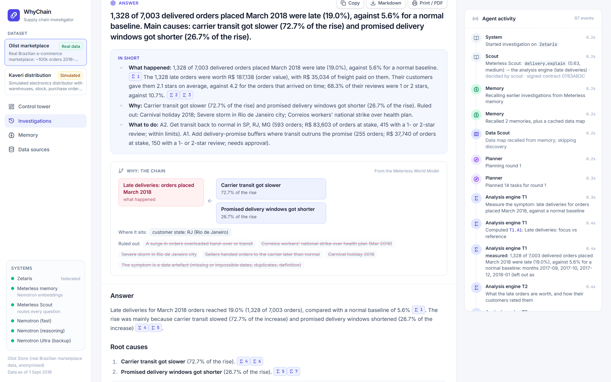
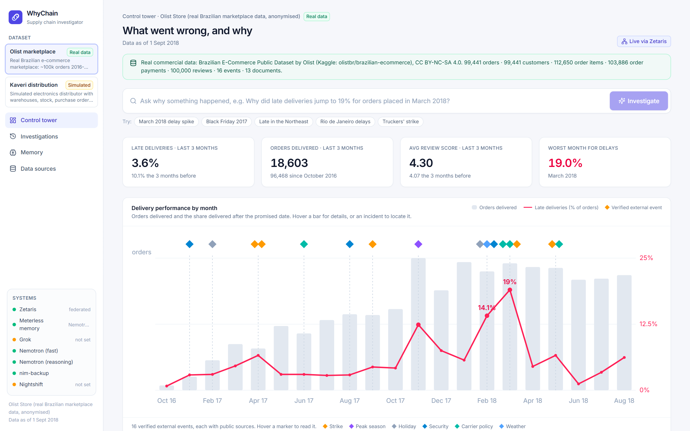
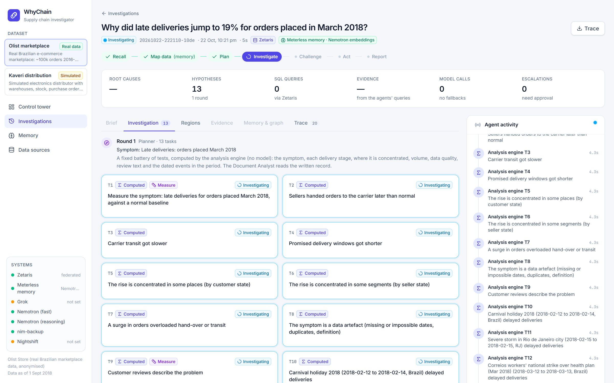
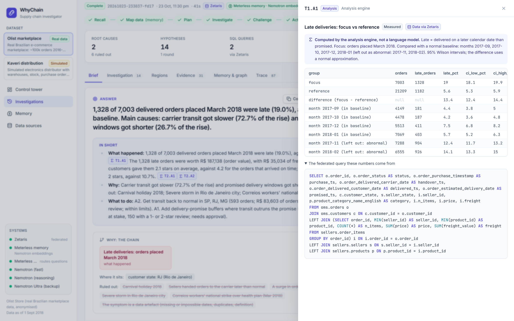
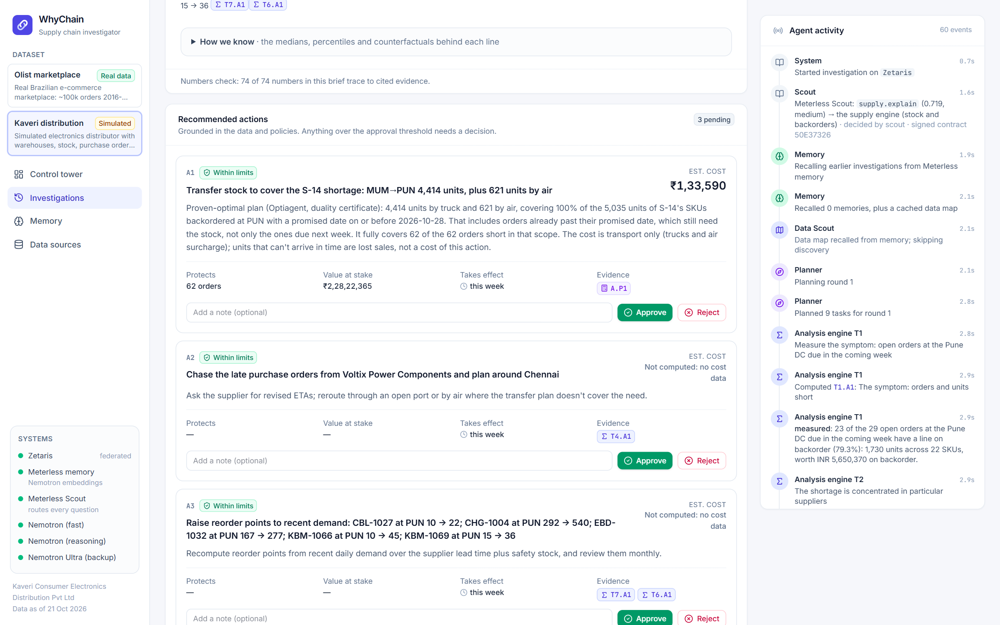
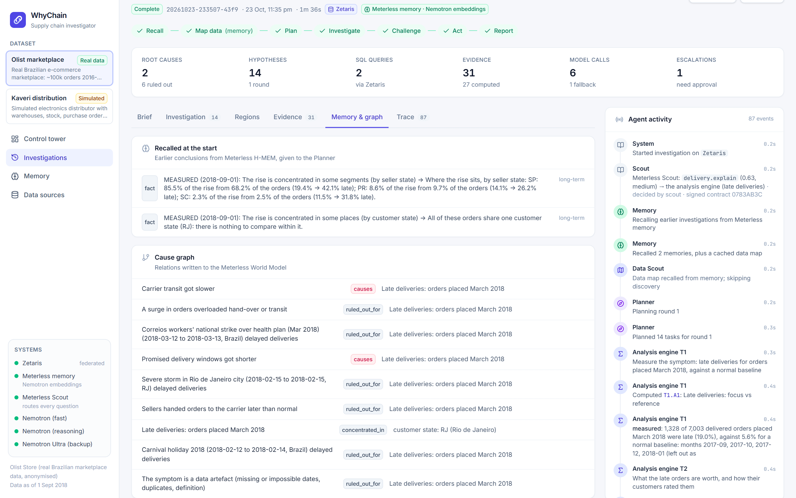
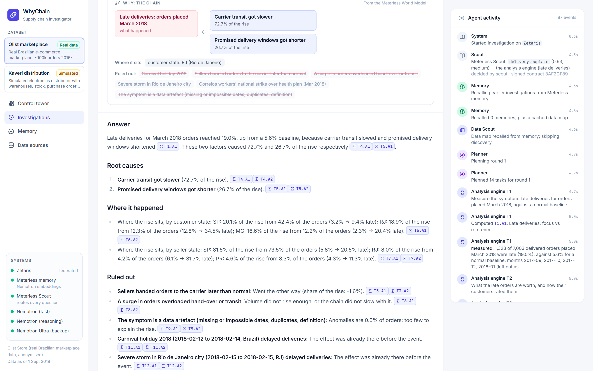
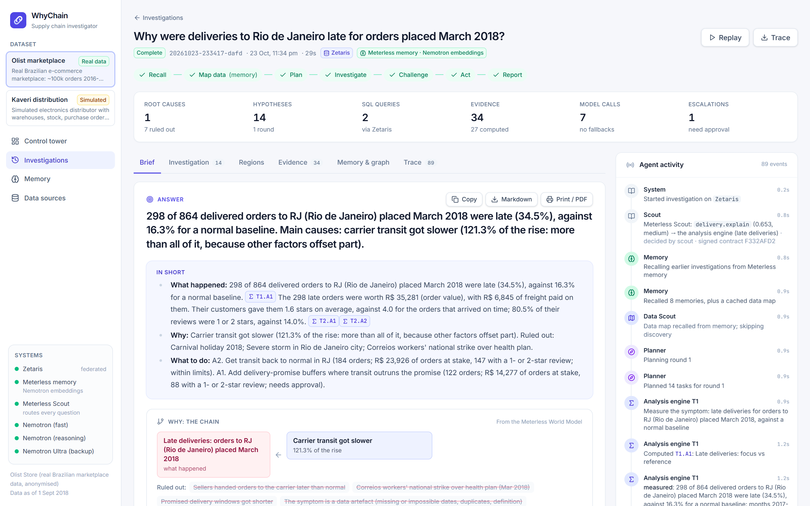
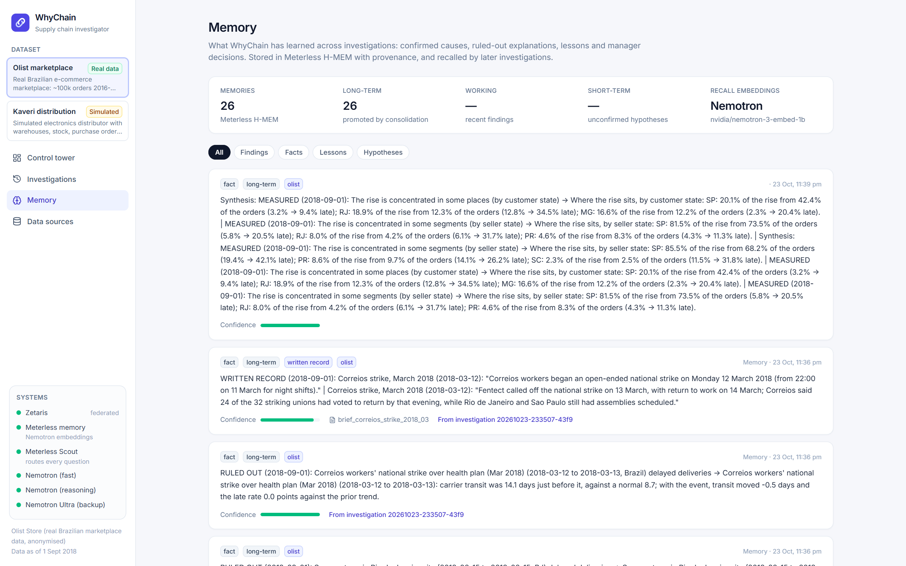
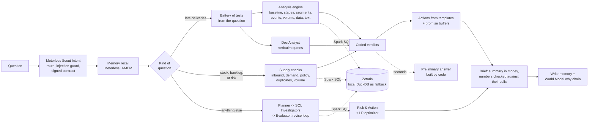

# WhyChain

[](https://github.com/Dakshhhhh-ops/whychain/actions/workflows/tests.yml)

**WhyChain is an agent that explains *why* a supply chain problem happened: each cause with its share of the problem, the red herrings it ruled out, and what to do, in money. Every number traces back to the query behind it.**

Open Agent Hackathon 2026 · Team **Peak** · **Demo video: [VIDEO LINK]**



**Why it matters.** When deliveries go late, the answer is spread across the order system, seller exports, customer reviews and the news of the day. An analyst needs half a day to stitch it together; WhyChain does it in minutes and shows its working. On real data (Olist, 99,441 orders), orders placed in March 2018 were **19.0% late against a normal 5.6%**. Carrier transit explains **72.7%** of the rise and shorter delivery promises **26.7%**. The postal strike that month is **ruled out**: lateness was already high before it began. The 1,328 late orders were worth **R$ 187,138**, and their customers rated them **2.1 stars against 4.2** for the orders that arrived on time.

### How WhyChain uses the sponsor technologies

| Requirement | How WhyChain meets it | Where to see it |
|---|---|---|
| **Zetaris** as the data layer | The only path to company data: one federated Spark SQL layer over the Postgres order system and the file exports, read in place (26 tables, row counts checked). The analysis engine, the agents' SQL and the dashboard all query through it. | "Data via Zetaris" on every piece of evidence; the Data sources page |
| A **Meterless** engine in a working feature | **Scout Intent** routes every question, refuses injected instructions and signs an execution contract (the spec's eval harness: every metric 1.000; routing 48/48; both in CI). **H-MEM** remembers findings with provenance; the **World Model** holds each run's why chain. | The activity feed (Technical detail), the Memory tab, the why chain on the brief |
| Meterless **Nightshift** | **Private documents**: contracts, email and news read only on the laptop's GPU, with a signed receipt per call that must say `local-only`. **Gateway** (`NIGHTSHIFT_PRIMARY=true`): every model call goes through Nightshift's cloud lane to NVIDIA Nemotron, each with its own receipt; tested on the March 2018 question (5 of 5 calls through Nightshift, same answer). Off by default: through Nightshift the model always reasons first, so calls take 40 to 55 s instead of 5 to 15. | The "Private documents · Nightshift" badge; the Trace tab (receipt id, route, egress on each call) |
| **NVIDIA Nemotron** | Nemotron 3.5 Super runs the agents, 3 Ultra is the fallback, 3 Embed powers memory recall, and 3 Nano 4B reads private documents on the local GPU. No model ever produces a number in the brief. | The Trace tab lists every model call |

### Quick start (no Docker or Zetaris needed; about 10 minutes)

```bash
python3.12 -m venv .venv && source .venv/bin/activate && pip install -e ".[dev]"   # Windows: py -3.12 -m venv .venv; .venv\Scripts\activate; pip install -e ".[dev]"
cp .env.example .env                                              # set NVIDIA_API_KEY and WHYCHAIN_HARNESS=local
python -m datagen.olist --no-postgres && python -m datagen.generate && (cd frontend && npm ci && npm run build) && python -m whychain.api
```

**See a finished investigation without installing anything:** read the two sample briefs on GitHub, [March 2018 on real Olist data](runs/20261028-004653-0e90/brief.md) and [Pune orders at risk on the simulated distributor](runs/20261027-022755-6d02/brief.md) (both run through Zetaris). After the quick start, the app replays either one with no API keys and no Docker: open `http://localhost:8000/runs/20261028-004653-0e90?replay=1`. On macOS or Linux, `./start.sh` starts the full stack (`start.cmd` on Windows).

Then open http://localhost:8000 and click **March 2018 delay spike**. The full setup, with Zetaris, Postgres and the Meterless bridge, is under [Setup](#setup-clean-machine).

**Results.** In the final test pass, at one commit with every query through Zetaris, WhyChain found the root cause in **18 of 18** questions, avoided the red herring in 15 of 15 and proposed the right action in 8 of 8. Four of those questions were held out and passed. All ground truth was written by the author (the simulated company's causes were planted), so these are development checks, not independent validation; across every question's first run so far, 9 of 10 passed and 1 failed (KH2). Details: [docs/RESULTS.md](docs/RESULTS.md).

### Screenshots

| Control tower | A preliminary answer in seconds | The brief: in short, in money |
|---|---|---|
|  |  |  |
| **Every number opens its evidence and SQL** | **A proven-optimal fix, sized from the data** | **Memory with provenance** |
|  |  |  |
| **The why chain, from the Meterless World Model** | **Ask why next: one click deeper (Rio de Janeiro)** | **Memory with provenance** |
|  |  |  |

### See it in five minutes

1. Start it: on Windows run `start.cmd` (Docker, Zetaris, Postgres, the Meterless bridge, the app, then a warm-up), or follow [Setup](#setup-clean-machine). Open http://localhost:8000.
2. Olist (real data): click **March 2018 delay spike** under the search box. A **preliminary answer**, computed from the data, appears within seconds (after the warm-up); the full brief, with the written record and the short written answer, follows in two to three minutes.
3. The brief opens with **In short** (what happened, why, what to do, in money) and the **why chain** drawn from the Meterless World Model; the detail (where it happened, what was ruled out, what customers wrote) is folded underneath. Sources are numbered 1, 2, 3 in reading order: hover one to see what it is, click it for the computed table and its SQL ("Data via Zetaris"). Open **Ruled out** for the strike.
4. Switch to **Kaveri** and run **Pune orders at risk**: the proven-optimal stock transfer, then **Approve** it to get the transfer order and supplier email.
5. Open **Memory** (findings with provenance, recall on Nemotron embeddings) and **Data sources** (federated by Zetaris).

### Contents

[The problem](#the-problem) · [How it works](#how-it-works) · [Tech stack](#tech-stack) · [Prescriptive layer](#prescriptive-layer-proven-optimal-stock-transfers) · [Sponsor technology](#sponsor-technology-designed-role-and-actual-status) · [How the sponsor technologies are used](#how-the-sponsor-technologies-are-used) · [Setup](#setup-clean-machine) · [Usage](#usage) · [The data](#the-data) · [Results](#results) · [Nemotron](#how-whychain-uses-nvidia-nemotron) · [Reliability](#reliability) · [Known limitations](#known-limitations) · [Repository layout](#repository-layout) · [Third-party components](#third-party-components) · [Pre-existing work](#pre-existing-work-built-before-the-build-window) · [Development tools](#development-tools)

## The problem

**On real data.** In March 2018, 19.0% of orders on Olist, a Brazilian marketplace, arrived after the promised date, against about 4–6% in a normal month. The order system shows that it happened, but not why. The evidence is spread across order timestamps, seller hand-over records, customer reviews and the news of the time.

What the raw data shows, checked independently with SQL (not by the agents):
- **Transit:** carrier transit was about 13 days in February–March 2018, against about 8.5 in a normal month. Hand-over by sellers did not slow.
- **Rio de Janeiro:** worst hit. Transit doubled (9.7 → 20.7 days) and late deliveries rose from 6% to 34%, against 16.8% in the rest of Brazil.
- **The 12–13 March Correios strike:** lateness was already high before it.

**In a simulated company,** where the agents can also act on stock: a planner sees that 23 of the 29 open Pune orders due next week have a line on backorder. The answer to "why?" is spread across five systems and three inboxes:

- the **ERP** shows the backorders;
- the **warehouse export** shows the Pune DC running dry while Mumbai has surplus;
- the **procurement export** shows the supplier's revised ETA;
- the supplier's **email to procurement** explains the delay (a Chennai port strike);
- the **contract** says the strike is force majeure, so no penalty can be recovered;
- the key **customer's contract** says every late day costs 1.5% of order value.

A good analyst needs half a day to stitch that together. WhyChain does it in minutes, and shows its working.

## How it works

WhyChain splits the work between **code that computes** and **agents that plan, read and write**. Numbers and verdicts come from code; language models never produce a number that reaches the brief.

**Routing: Meterless Scout Intent.** Every question goes first to Scout (`meterless_bridge/scout/`), which scores it against WhyChain's intent registry (late deliveries, a shortage, an open investigation, or not a question about the data), with Nemotron embeddings as its semantic stage, checks it for prompt injection, and returns a signed execution contract. WhyChain follows Scout when it is confident and its own word rules otherwise; each run records both, and a question the guard blocks is refused before any agent sees it.

**Questions about late deliveries** (the real Olist data, and lateness questions on the simulated company) run on the **analysis engine** (`whychain/analysis/`):

1. **One federated query** pulls order-level facts through the data harness. That's one row per order: purchase, hand-over to the carrier, delivery, promised date, place, seller, carrier. "Late" has one definition: delivered on a later calendar date than promised.
2. **The question becomes a fixed battery of tests** (`battery.py`). The period, places and named events are read from the question with plain rules. The same kind of question always gets the same tests:
   - **the symptom** against a *normal* baseline: the months (or weeks) before, minus any that were themselves abnormal;
   - **the value at stake**: what the late orders were worth (order value, and freight on Olist) and how their customers rated them against the on-time orders (review stars, and the share of 1- or 2-star reviews);
   - **each delivery stage** (seller hand-over, carrier transit, the promise): counterfactual late rates where a stage takes its baseline distribution, matched like with like by area. Exact **Shapley values** split the rise, so the shares add up;
   - **waiting for stock** (datasets with stock data): were the slow hand-overs orders waiting for stock the warehouse didn't have on their requested ship date? A counterfactual gives the hand-over without those waits, and the short lines name the suppliers and any promotion behind their demand. This explains the dispatch stage rather than counting as another cause, and changes its action from "enforce hand-over deadlines" to "clear the stock-outs";
   - **where it sits**: a shift-share split of the rise by area, seller state or carrier, separating "it got worse there" from "more orders came from there";
   - **volume**: orders per day against the four weeks before (business growth is not a surge);
   - **dated events** in or near the period: weekly transit and lateness, by the week parcels were handed to the carrier, against the **prior trend**. An event counts only if the change starts with it, and for a regional event, only if it is larger in that region. An event that ended before the period asked about is not counted as a cause of it (whether its backlog carried over isn't tested);
   - **data quality and definitions**, and **what customers wrote** (review mentions per thousand orders);
   - for regional questions, a second comparison with **places at a similar distance** (similar promised times), to separate distance from everything else.
3. **Coded verdicts.** A stage is a cause if it explains at least 10% of the rise **and** the stage itself moved the late way: its average by a quarter day or more, or its typical (median) or four-in-five (80th percentile) time by a day or more (for promises: shorter). The second condition was added after held-out case KH2: on 98 orders, transit that hadn't changed (typically 2.0 against 2.0 days) picked up 14.6% of the rise from noise in the counterfactual. An event is a cause only if the effect starts with it. Volume counts only if orders rose 25% or more and the chain slowed with it. The thresholds are in the code and the brief.
4. **Agents** around the engine:
   - the **Document Analyst** reads the written record and must quote it verbatim. Documents are context, never a cause: dated events are judged by the event test;
   - **actions** come from templates per confirmed cause, sized with computed tables (e.g. the promise buffer each state needs). Each carries the value at stake: what exactly the orders it would have turned on time are worth, and how many of them left a 1- or 2-star review. That is not what the fix would cost, which the data doesn't hold;
   - a model writes only the brief's short answer, from the computed facts. Every number in the brief is checked against its cells and marked "(unverified)" if it isn't there.

A late-delivery investigation takes 5 to 9 model calls and gives the same numbers on every run. The computed tests take seconds, so the planner runs them straight away and publishes a **preliminary answer** built by code (the summary, the causes and the sized actions) while the Document Analyst reads and the model writes; the final brief, 1.5 to 4 minutes later through Zetaris, adds the written record and the short written answer. The tables pulled through Zetaris (Olist's order facts and reviews take about a minute) are shared by all runs in the process for 15 minutes, and `scripts/warmup.py` loads them into the app before the first question.

**The brief** opens with a summary written by code: what happened (with the value at stake), why (and what was ruled out), and what to do, in money. Root causes are one line each; the medians, percentiles and counterfactuals behind them sit under **How we know**, folded in the app. Above them the app draws the **why chain** (symptom, causes with their shares, what explains a cause, where it sits, what was ruled out) from the relations the run wrote to the Meterless World Model.

**Stock-outs, backlogs and orders at risk** (the simulated company) run on the **supply engine** (`whychain/analysis/supply.py`), built the same way. The warehouse, product category and time window come from the question, and the same checks always run on order lines, stock, purchase orders and the external signals:
- **inbound supply**: purchase orders overdue against their expected date, by supplier and port of entry, set against the port status feed;
- **demand**: units ordered against the reorder baseline, naming the promotions behind a spike;
- **reorder policy**: reorder points below what current demand needs, and when they were last reviewed;
- **duplicate orders**: orders repeated under the same external reference, judged by the units the extra copies order (they are counted once in every other check);
- **order volume** against the weeks before.

A check is a cause when it is involved in at least 25% of the short units. The shares overlap (one SKU can be both late inbound and under a stale reorder point), and a disrupted port is reported as the reason purchase orders are late, not as a separate cause. Actions come from the same numbers: the proven-optimal stock-transfer plan, which purchase orders to chase, which reorder points to raise, which duplicates to cancel.

**Any other question** uses the **agent loop**:
- the Data Scout maps and join-tests the sources;
- the Planner sets competing hypotheses;
- Data Investigators write SQL;
- the Evaluator re-runs every cited query and challenges the reasoning, sending gaps back for another round;
- the Risk & Action agent calls the **stock-transfer optimizer** (a linear program, see below), with a duality certificate proving no cheaper plan exists;
- the **Action Executor** prepares transfer orders, cancellation lists and draft emails after a manager approves.

The same numbers check applies to findings, actions and the brief.

Both paths write confirmed and ruled-out causes, with their provenance, to **Meterless H-MEM** (the written record as its verified quotes only), and the why chain to the **Meterless World Model**.



## Tech stack

| Layer | Technology |
|---|---|
| Agents and orchestration | Python 3.12, LangGraph (parallel fan-out per task, bounded revise loop), one OpenAI-compatible client with role-based fallback chains, retries and per-endpoint concurrency slots |
| Models | NVIDIA NIM: Nemotron 3.5 Super (JSON mode, or reasoning on for planning and judging), Nemotron 3 Ultra (fallback), Nemotron 3 Embed (memory recall). Meterless Nightshift: Nemotron 3 Nano 4B on the local GPU (private documents) |
| Analysis | pandas; counterfactual late rates per delivery stage, exact Shapley attribution, shift-share decomposition, event tests against the prior trend, coded verdict rules |
| Data | Zetaris (Spark SQL over a Postgres JDBC datasource and Lightning file tables, read in place); DuckDB with sqlglot dialect translation as the fallback; Postgres in Docker |
| Optimization | Transportation linear program; OR-Tools GLOP, with COIN-OR CLP as the second solver; duality certificate (below) |
| Memory and routing | Meterless H-MEM, World Model and Scout Intent in TypeScript (Node 20, tsx) behind an HTTP bridge |
| API | FastAPI with Server-Sent Events for live runs, served by uvicorn |
| Frontend | React 19, TypeScript, Vite, Tailwind CSS 4, react-markdown, react-router 7 |
| Quality | pytest, ruff, GitHub Actions: Python tests, lint, frontend build, bridge type check, H-MEM and World Model conformance, Scout evals and routing |

## Prescriptive layer: proven-optimal stock transfers

For stock-outs on the simulated distributor, the only dataset with stock, lanes and freight costs, `whychain/optimize.py` builds a transportation linear program from live data, solves it and proves the plan optimal. The real Olist data has no cost data, so its actions carry the value at stake (what the orders they protect are worth, and their reviews) rather than a cost (see "Known limitations").

**Model.** Variables $x_r \ge 0$: units moved on route $r$, from a source (a DC's spare stock of a SKU, or the supplier by air) to a destination (backordered units of that SKU at a DC). One extra route per SKU, "unfilled", carries what can't arrive in time.

$$\min \sum_r c_r x_r \quad \text{s.t.} \quad \sum_{r \to d} x_r = \text{need}_d \;\; \forall d, \qquad \sum_{r \leftarrow s} x_r \le \text{spare}_s \;\; \forall s$$

| Part of the model | Where it comes from |
|---|---|
| Destinations | Backordered units per DC and SKU, due within the deadline (`erp.order_lines` + `erp.sales_orders`) |
| Sources | Spare stock per DC and SKU = on hand − allocated − policy cover (`wms.inventory_snapshots`, `wms.reorder_policy`) |
| Truck routes | Lane cost per unit and transit days (`wms.transfer_lanes`). Lanes too slow for the deadline are left out. |
| Air routes | Supplier air-freight surcharge and lead time (`procurement.expedite_options`) |
| Can't arrive in time | A unit with no route that meets the deadline costs its list price (lost sale), so the plan reports it instead of hiding it |

**Solve and certify.** OR-Tools GLOP solves the LP, and the plan is re-checked against the original rows. A **duality certificate** (dual feasibility, and primal and dual objectives equal) proves no cheaper plan exists. On degenerate problems GLOP's dual prices can be valid but loose; the certificate is then recomputed from CLP's dual prices, and if neither closes the proof, the plan is withheld rather than shown unproven. An LP has no fixed cost per truck, so lanes carrying less than 15% of a truck's capacity are dropped and the problem is re-solved. The Action Executor's transfer order *is* the certified plan, row for row.

## Sponsor technology: designed role and actual status

This table separates what the code is built to do from what has actually run. Runs before 22 Oct 18:03 IST used the local DuckDB harness; runs since then go through the **local Zetaris platform**. Every model call so far has gone to **NVIDIA NIM**.

| Sponsor | Designed role | Status today |
|---|---|---|
| **Zetaris** | The single path from agents to data. Sources are registered once (`scripts/register_zetaris.py`), and agents write federated Spark SQL across them. | **Connected: the local Zetaris platform (the hackathon Docker bundle).** Both datasets are registered: the order systems through a Postgres JDBC datasource, the exports as Lightning file tables read in place (26 tables, every row count matching). The engine's fact query, the agents' SQL, the catalog the Data Scout maps and the dashboard all go through it. Not used: Zetaris Cloud (the client has a cloud mode, untested). DuckDB remains as the fallback. |
| **Meterless** | Three engines via `meterless_bridge/`, plus Nightshift: **Scout Intent** routes every question (WhyChain's implementation of the spec, which ships no code), **H-MEM** memory with provenance, and the **World Model** cause graph (the reference engines run as libraries). H-MEM's recall uses **NVIDIA Nemotron embeddings** (`nvidia/nemotron-3-embed-1b`) in place of its reference mock embedder. **Nightshift** reads the written record on this machine's GPU when **Private documents** is ticked (off by default). | **Scout Intent, H-MEM and World Model: used in every run.** Scout since 23 Oct (commit `669061f`): the spec's own eval harness (vendored unchanged, a 32-example smoke set) passes with every metric at 1.000 and a clarification rate of 0.125 (0.094 with Nemotron embeddings as its semantic stage); on all 48 questions WhyChain knows, its route equals WhyChain's word rules (`scout/test-routing.ts`). The World Model holds each run's why chain, which the brief draws. H-MEM: Nemotron embeddings since 22 Oct 19:21 IST (earlier runs used the reference hash mock, so similarity recall was weak); WhyChain still filters recalled findings by question similarity. Exactly one vendored file changed: a provider hook in H-MEM's `embeddings.ts` (see "Third-party components"); H-MEM conformance passes 13/13 with the provider off and on. In a recall test with reworded questions (`scripts/recall_demo.py`), the right finding came first for 5 of 6 questions with Nemotron, 2 of 6 with the mock. **Nightshift: running since 24 Oct, used when Private documents is ticked** (NVIDIA Nemotron 3 Nano 4B on the laptop's RTX 4050; see "Private documents"). With the box unticked, as in every result reported here, the Document Analyst runs on NVIDIA's cloud, so documents *are* sent to NIM. |
| **NVIDIA** | NIM serves **Nemotron 3.5 Super** (`nvidia/nemotron-3.5-super-vl-120b-a12b`). Reasoning ("thinking") is on for the Planner and Evaluator, and off, in JSON mode, for the other agents. **Nemotron 3 Ultra** (`nvidia/nemotron-3-ultra-550b-a55b`) is the backup model. **Nemotron 3 Embed** (`nvidia/nemotron-3-embed-1b`) embeds every memory and recall query for Meterless H-MEM. | **Used in every run** (cloud NIM). The local GPU runs **NVIDIA Nemotron 3 Nano 4B** (`nvidia/NVIDIA-Nemotron-3-Nano-4B-GGUF`, Q4_K_M) in Nightshift for private documents: the Nemotron models in Nightshift's own catalog are 30B and don't fit a 6 GB laptop GPU, so NVIDIA's 4B release was downloaded into Nightshift. |
| **xAI Grok** | Optional first choice for the reasoning roles. | **Not configured;** no run has used it. |

Every model call goes through one OpenAI-compatible client with role-based fallback. Providers that aren't configured are skipped, so **with today's configuration every chain runs entirely on NVIDIA's NIM endpoint**: Nemotron 3.5 Super, then a different model, Nemotron 3 Ultra. That covers one model being overloaded, which is the usual NIM failure, but not an outage of the NIM endpoint itself. Grok, Nightshift or a local Ollama model would make the chain independent: setting `OLLAMA_BASE_URL` and `OLLAMA_MODEL` in `.env` (see `.env.example`) adds a model on your own machine at the end of every chain. It was tried with `qwen3:8b` (the client turns its thinking off): about 30 s per answer, and it needs about 6 GB of free memory, which the development laptop did not have alongside Docker and Zetaris, so it is off in every result reported here.

| Role | Used by | Order (configured today in bold) |
|---|---|---|
| `reason` | Planner, Evaluator | Grok → **Nemotron 3.5 (thinking)** → **Nemotron 3 Ultra** → **Nemotron 3.5** → Nightshift |
| `work` | Data Scout, Data Investigators, Risk & Action, Reporter, Action Executor | **Nemotron 3.5** → **Nemotron 3 Ultra** → Grok → **Nemotron 3.5 (thinking)** → Nightshift |
| `local` | Document Analyst | **Nemotron 3.5** → **Nemotron 3 Ultra** → **Nightshift** → Ollama |
| `private` | Document Analyst, when Private documents is ticked | **Nightshift** (`meterless/local`) only: no cloud fallback |

Transient errors (5xx, rate limits, timeouts) are retried with back-off: twice when another provider follows, four times on the last one. The trace records every retry and fallback.

## How the sponsor technologies are used

**How Zetaris is integrated.** Zetaris is the only path from WhyChain to company data. The local Zetaris platform (the hackathon's Docker bundle) federates six source systems per dataset: the order systems through a Postgres JDBC datasource, and the CSV and JSON exports as Lightning file tables read in place, so nothing is copied into a warehouse or a vector store. `scripts/register_zetaris.py` registers them and checks every table's row count against the source (26 tables, all matching). Everything queries through it: the analysis engine's order-level fact query, which joins the Postgres order system with the seller export (five tables) in one statement; the agents' own Spark SQL; the catalog the Data Scout maps; and the dashboard. Every run records `harness: zetaris`, and every cited result can be re-run through it.

**How Meterless is integrated.** `meterless_bridge/` runs three Meterless engines behind a small HTTP service. **Scout Intent** decides which part of WhyChain answers each question, guards against prompt injection and signs an execution contract; its spec ships no code, so WhyChain implements it (`meterless_bridge/scout/scout.ts`) and checks it with the spec's own eval harness and a routing test, both in CI. **H-MEM** stores every confirmed and ruled-out finding with provenance (run, agent, query or document), and each new investigation recalls related past findings as hints, never as evidence. The **World Model** stores the cause-effect relations each run confirms (the why chain the brief draws: causes with their shares, what explains them, where the problem sits, what was ruled out), as a cause graph across runs. H-MEM's recall uses NVIDIA Nemotron embeddings in place of its reference mock embedder: exactly one vendored file changed, to add a provider hook (see "Third-party components"). Conformance passes with the provider off and on. **Nightshift** runs a local model on the laptop's GPU and reads the written record when Private documents is ticked; each call's signed receipt must say `local-only` (see "Private documents").

**Meterless in working features.** Three engines, each in a working feature with passing tests that run in CI on every push (`.github/workflows/tests.yml`), plus Nightshift for private documents:

| Meterless engine | Working feature | Passing tests |
|---|---|---|
| **Scout Intent** | Routes every question to the part of WhyChain that answers it, refuses injected instructions, signs an execution contract | The spec's own eval harness (`npm run scout:evals`: every metric 1.000) and WhyChain's routing test (`npm run scout:routing`: 48/48) |
| **H-MEM** | Memory of every confirmed and ruled-out finding with provenance, recalled by later investigations (Nemotron embeddings) | H-MEM conformance 13/13 (`npm run conformance`); recall demo, right finding first 5 times in 6 (`scripts/recall_demo.py`) |
| **World Model** | Each run's why chain, drawn in the brief; the cause graph across runs | World Model conformance 8/8 (`npm run conformance`); `tests/test_pipeline.py` |
| **Nightshift** | Private documents: the written record is read on this machine's GPU, with a signed receipt per call | `tests/test_private_docs.py` (7 tests); live run below |

### Private documents (Meterless Nightshift)

Contracts, supplier email and news can be sensitive. Tick **Private documents** under the search box (or run the CLI with `--private-docs`) and the Document Analyst reads them only on this machine, through Meterless Nightshift:

- Calls go to Nightshift's `meterless/local` route ("on-device only") under the app name `whychain-private`, which Nightshift's app policy binds to local lanes. There is no cloud fallback: if Nightshift can't answer, the record goes unread and the brief says so.
- Every reply carries Nightshift's signed compute receipt. WhyChain checks it and discards any reply whose receipt doesn't say `privacy: local-only`; the trace records each receipt id, route and egress (`none`).
- A small local model can't drive the Document Analyst's agent loop (with Llama 3.2 1B it searched the wrong month and never returned valid JSON). So private reading is simpler: code fetches the documents dated near the period in question (plus undated contracts and policies), numbers their sentences, and asks the local model one short question per document: is it relevant, and which sentences? Code then copies those sentences word for word, so every quote is exact by construction. Documents dated inside the period are always kept.
- Quotes from private documents are not written to memory (H-MEM embeds text on NVIDIA's cloud).
- Scope: delivery and supply questions, where code judges the written record. In the open-ended agent loop, cloud models review the Document Analyst's findings, so private mode there keeps the documents' full text local but not its findings.

**The local model: NVIDIA Nemotron 3 Nano 4B**, NVIDIA's own GGUF release (`NVIDIA-Nemotron3-Nano-4B-Q4_K_M.gguf`, 2.8 GB), run by Nightshift on the laptop's RTX 4050 (6 GB). Nemotron 3 Nano reasons before it answers; through Nightshift, a per-request switch to turn that off is ignored, and with the model server's default settings half the documents came back empty (the answer was filed as reasoning). The Nightshift lane therefore starts the model server with `--reasoning-format none --reasoning-budget 0` and a 2,048-token context; WhyChain strips any thinking tags itself.

Live run, 24 Oct 03:33 IST, March 2018 question, local data copy (Docker was stopped to free memory), Nightshift on Nemotron 3 Nano 4B: all 8 documents near the period read locally (46.6 s in all, at most 15.9 s for one), all 8 receipts `local-only` with egress `none`; the brief quotes the March 2018 Correios price rise and strike; headline, causes and shares identical to the cloud runs (19.0%; transit 72.7%, shorter promises 26.7%). Earlier the same evening Llama 3.2 3B did the same job in 4.8 s; Nemotron is slower on this laptop because it was under heavy memory pressure (16 GB RAM, many apps open). Nightshift needs free RAM to load a model: its memory reserve was lowered (Nightshift `settings.json`: `system_reserve_mb` 1024, `emergency_headroom_mb` 512; it rejects lower headroom), and Chrome had to be closed.

**Where NVIDIA technology contributes.** Every language-model call runs on Nemotron through NVIDIA NIM: Nemotron 3.5 Super for the agents (document reading with verified quotes, the brief's short answer, and the agent loop's planning, SQL and evaluation, with reasoning on for planning and judging), and Nemotron 3 Ultra as the fallback when 3.5 Super is overloaded. Nemotron 3 Embed (`nvidia/nemotron-3-embed-1b`) embeds every memory and recall query for Meterless H-MEM. See "How WhyChain uses NVIDIA Nemotron".

**What is unique about this use.** The sponsor technologies sit where they carry weight, not decoration:
- Zetaris carries the one federated query that every computed number traces back to, so a judge can click any figure in a brief, see its SQL and re-run it through Zetaris.
- Meterless Scout Intent sits in front of every question: a signed contract records which engine answered and why, and a question carrying instructions for the agents is refused before any model sees it.
- Meterless memory is reused only under rules (a similar question, never as evidence), and its recall runs on Nemotron embeddings: a reworded question finds the right past finding 5 times in 6, against 2 in 6 with the mock (`scripts/recall_demo.py`).
- Nemotron reads, plans, quotes and writes, but never produces a number or a verdict: those come from code and are checked against their cells. That design cut model calls per real-data question from 50 to 70 down to 5 to 9, and made the answers reproducible run to run.

## Setup (clean machine)

**Needs:** Python 3.12 or 3.13 (not 3.14), Node 20+, git, and internet access (the Olist data downloads from a public mirror). Docker for Postgres and Zetaris. An `NVIDIA_API_KEY` from build.nvidia.com for the models.

**What works without what:** without Docker, the order systems are read from CSV copies; without Zetaris, every query goes to a local DuckDB copy with the same tables (the app says so); without an NVIDIA key, late-delivery and supply investigations still compute every finding and the brief's short answer is written by code (open-ended questions need a model); without the Meterless bridge, memory falls back to a local file. `python -m whychain.doctor` says which of these is in use.

**Quickest path (no Docker, no Zetaris, about 10 minutes):** the same analysis on the local DuckDB copy of the same tables; the app shows "Local data (fallback)" instead of Zetaris.

```bash
py -3.12 -m venv .venv && .venv/Scripts/python -m pip install -e ".[dev]"   # macOS/Linux: python3.12 -m venv .venv && .venv/bin/pip install -e ".[dev]"
cp .env.example .env                 # set NVIDIA_API_KEY, and WHYCHAIN_HARNESS=local
.venv/Scripts/python -m datagen.olist --no-postgres     # real Olist data from CSV, about 6 minutes
.venv/Scripts/python -m datagen.generate                # the simulated company (seconds)
cd frontend && npm install && npm run build && cd ..
.venv/Scripts/python -m whychain.api                    # http://localhost:8000
```

Without the Meterless bridge, memory falls back to a local file; start it (step 4 below) for Meterless memory, the World Model why chain and Scout routing.

**On Windows**, once steps 1 to 5 have been done once, `start.cmd` starts everything (Docker, Zetaris, Postgres, the bridge, the app) and warms it up.

```bash
# 1. Python environment (uv, or plain venv + pip)
uv venv && uv pip install -e ".[dev]"
#    or: py -3.12 -m venv .venv  then  .venv/Scripts/python -m pip install -e ".[dev]"   (Windows)
#        python3.12 -m venv .venv && .venv/bin/pip install -e ".[dev]"                   (macOS/Linux)
# Activate it so `python` below is this environment:
source .venv/Scripts/activate        # Git Bash on Windows;  PowerShell: .venv\Scripts\Activate.ps1;  macOS/Linux: source .venv/bin/activate

# 2. Config
cp .env.example .env                 # then set NVIDIA_API_KEY (and the Zetaris login for step 5)

# 3. The data: order systems in Postgres, other systems as files
docker compose up -d                 # Postgres on port 5433
python -m datagen.olist              # real Olist data: ~150 MB download + build, about 6 minutes; also loads Postgres
                                     #   (no Docker? add --no-postgres; the CSV copies are used instead)
python -m datagen.generate           # simulated company: writes data/generated/ (seconds)
python -m datagen.load_postgres      # loads the simulated company's order system into Postgres

# 4. Meterless engines bridge (separate terminal)
cd meterless_bridge && npm install && npm start  # http://localhost:8787 (Nemotron embeddings if NVIDIA_API_KEY is set)

# 5. Zetaris: the hackathon's local platform bundle, from the event's resources, in its own folder:
#    copy docs/zetaris-override.yml there as docker-compose.override.yml (it mounts WhyChain's data),
#    set WHYCHAIN_DIR, docker compose up -d; put the admin login in WhyChain's .env (ZETARIS_USER/PASSWORD)
#    and the bundle's folder as ZETARIS_DIR (for start.cmd)
python scripts/register_zetaris.py   # registers both datasets, then checks every table's row count

# 6. Check everything
python -m whychain.doctor
python -m pytest -q tests            # if Windows temp permissions get in the way: add --basetemp=.pytest_tmp
```

With `WHYCHAIN_HARNESS=zetaris`, every query goes to Zetaris: Postgres through a JDBC datasource, the CSV and JSON exports as Lightning file tables read in place. With `WHYCHAIN_HARNESS=local` (or if Zetaris is unreachable), the same sources and table names are served by DuckDB, with the ERP read live from Postgres. Agents write the same Spark SQL either way; for DuckDB it's translated with sqlglot. The UI always shows which harness answered.

How the two compare (`scripts/register_zetaris.py` and the checks behind this commit): every table has the same row count; the computed findings for all 11 eval questions are identical; agent-style queries (cross-source joins, date arithmetic) return the same rows. Zetaris takes 0.2 to 1.3 s per query where DuckDB takes milliseconds, and the first fact load of a session about 17 s instead of 8 s.

## Usage

```bash
# Web app: build the frontend once, then serve API + UI together
cd frontend && npm install && npm run build && cd ..
python -m whychain.api                           # http://localhost:8000

# Frontend development with hot reload (proxies /api to :8000)
cd frontend && npm run dev                       # http://localhost:5173

python -m whychain.cli "Why did late deliveries jump to 19% for orders placed in March 2018?"
python -m whychain.cli --dataset kaveri "Why have deliveries to Nashik been late since September?"
python -m evals.run_evals --dataset olist        # score the real-data cases (or --dataset kaveri, or all)
python -m pytest -q tests                        # the test suite (no API keys needed)
```

### The app

| Screen | What it shows |
|---|---|
| **Control tower** | On real data: a monthly chart of orders and late deliveries, with **verified external events** marked on it (hover one to read it, with links to its sources), KPI cards, and **incidents found in the data** by plain SQL rules (late-delivery spikes, missed seller hand-overs, review-score dips, reviews mentioning strikes, chronically late states). Each incident has an **Investigate why** button. On the simulated company: live KPIs, a **Needs attention** list (lanes whose on-time rate fell, backordered DCs, late suppliers, disrupted ports) and a supply network map coloured by live status. |
| **Investigation (live)** | Agents stream their work as it happens (Server-Sent Events). A stage tracker runs Recall → Map data → Plan → Investigate → Challenge → Act → Report. The hypothesis board updates as findings and verdicts arrive, including the Evaluator's send-backs, and the activity feed shows every query, document read, re-verification and escalation in plain words; **Technical detail** adds the evidence ids, Scout's intent and confidence, and its signed contract. |
| **Brief** | The answer, with every number citing clickable evidence; recommended actions with cost and approve/reject (decisions are written to Meterless memory); risks; lessons saved. Export to Markdown or print to PDF. |
| **Deliverables** | After approval, the Action Executor's output appears on the action card: transfer orders, cancellation lists and draft emails, each downloadable. |
| **Regions** (real data) | A tile map of Brazil's 27 states. It shows how much each state's late-delivery rate rose in the month the question is about, against a normal baseline (the six months before, leaving out months that were abnormal nationally), and outlines the states named in the confirmed causes. Hover a state for its late rate and carrier transit time. |
| **Network** (simulated company) | The supply network with the confirmed cause's path lit up, e.g. Voltix → Chennai port → Pune DC. |
| **Evidence** | Every SQL result (query, rows, re-verification badge) and every document quote (verified word for word). |
| **Memory & graph** | What was recalled from earlier runs, the cause graph in the Meterless World Model, and the data map's verified joins. |
| **Trace** | Every event, filterable by agent, downloadable as JSONL. Any finished run can be replayed. |
| **Memory** | Everything WhyChain has learned across runs, by tier (Meterless H-MEM). |
| **Data sources** | The six federated sources, their tables and columns, and the joins the Data Scout verified. |

Every run writes `runs/<run_id>/`:
- `trace.jsonl`: every agent step, SQL query, model call, fallback, verdict and escalation.
- `result.json`: plan, findings, evidence, verdicts and actions.
- `brief.md`: the action brief.

## The data

WhyChain ships with two datasets. The sidebar switches between them; the agents, prompts and UI are the same for both.

### 1. Olist: real Brazilian e-commerce data (default)

The [Brazilian E-Commerce Public Dataset by Olist](https://www.kaggle.com/datasets/olistbr/brazilian-ecommerce) (CC BY-NC-SA 4.0): 99,441 real, anonymised orders placed from 2016 to 2018. `python -m datagen.olist` downloads the original CSVs and splits them into the systems a marketplace would actually run, so the agents have to federate:

| Source | System | Tables |
|---|---|---|
| `oms` | Order management (Postgres) | `orders` (purchase, approval, carrier hand-over, delivery and promised dates), `customers` |
| `sellers` | Seller platform (CSV) | `order_items` (with each seller's shipping deadline), `sellers`, `products` |
| `payments` | Payment gateway (JSON) | `order_payments` |
| `feedback` | Customer reviews (JSON) | `reviews`: 100,000 real reviews, in Portuguese |
| `signals` | External events (JSON) | `events`: 16 verified events, 2017–2018 |
| `docs` | News briefs | `documents`: 13 briefs on those events |

Nothing is planted. The events (Correios strikes, the 2018 truckers' strike, Carnival, Black Friday, Rio de Janeiro's federal intervention and cargo-theft record, Correios price and policy changes) were researched for this project from public sources, mainly Agência Brasil and the official legal texts. Every event and brief lists its source URLs, and the control tower links to them. They are in `datagen/olist_events.json`, with summaries paraphrased rather than copied. The dataset is not redistributed in this repository; the script downloads it.

The control tower finds incidents with plain rules on the real data: months whose late-delivery rate is far above the median, months where sellers missed hand-over deadlines, falls in review scores, reviews that mention strikes, and states with chronic delays. Verified events are marked on the monthly chart.

### 2. Kaveri: a simulated distributor, for the full prescriptive loop

Olist has no warehouse stock to move, so the optimizer and stock-transfer deliverables are shown on a simulated company. It is fictional: **Kaveri Consumer Electronics Distribution**, with 3 DCs (Mumbai, Pune, Chennai), 11 suppliers, 74 SKUs and 52 retail customers. `datagen/generate.py` simulates 90 days of the business day by day: orders, ship-complete fulfilment, reorder-point replenishment, supplier lead times and carrier transit. Problems are planted as **causes**, not answers:

| Case | Planted cause | Red herring |
|---|---|---|
| A. Pune orders at risk | Chennai port strike strands Voltix (S-14) pre-build POs; Mumbai holds surplus | IMD rain alert in Pune |
| B. Nashik deliveries late | SwiftCargo's v2 contract moved the lane to a Tue/Fri consolidated milk-run | stock-outs |
| C. Mumbai earbuds stock-out | Marketing's DIWALI26 promo was never shared with planning; reorder points stale | port strike |
| D. Chennai backlog jump | EDI connector v3.2 retry bug duplicates orders (same `external_ref`) | thunderstorms |
| E. On-time rate drop | Several of the above at once | weather |

`evals/cases.yaml` holds the ground truth. The agents never see it.

## Results

Run `python -m evals.run_evals` (or `--dataset olist|kaveri`) to regenerate `evals/results.md`. A case passes "root cause found" when the expected terms appear, as whole words, in a cause the Evaluator confirmed or in the headline. Keyword scoring is crude; read the briefs too.

<!-- RESULTS -->
The final pass, question by question (times, routing, headlines and run ids), and every earlier pass are in [docs/RESULTS.md](docs/RESULTS.md).

**Final pass: root cause found in 18/18; red herring avoided in 15/15 cases that define one; right action in 8/8 cases that have one; held-out questions 4/4 (H1, HO1, KH1, KH4). Preliminary answer: median 3.5 s after the start (1 to 42 s).**

## How WhyChain uses NVIDIA Nemotron

Every language-model call goes to Nemotron: in the cloud through NVIDIA NIM, and, for private documents, on this machine's GPU through Meterless Nightshift (Nemotron 3 Nano 4B). In the cloud: **Nemotron 3.5 Super** (`nvidia/nemotron-3.5-super-vl-120b-a12b`), with **Nemotron 3 Ultra** (`nvidia/nemotron-3-ultra-550b-a55b`) as the backup model when the first is overloaded.

| Where | Nemotron's job | Mode |
|---|---|---|
| Document Analyst | Find and quote the written record (news briefs, contracts, email); quotes are verified word for word | 3.5 Super, JSON mode |
| Brief | Phrase the short answer from computed facts only; every number is then checked | 3.5 Super |
| Agent loop: Planner, Evaluator | Plan competing hypotheses; challenge findings, ask for another round | 3.5 Super with reasoning ("thinking") on |
| Agent loop: Data Scout, Investigators, Risk & Action, Action Executor | Map the data, write and repair SQL, call the optimizer, prepare deliverables | 3.5 Super, JSON mode |
| Fallback | Take over when 3.5 Super returns errors or rate limits | 3 Ultra |
| Memory (Meterless H-MEM) | Embed every finding written to memory and every recall query, so a new investigation finds related past findings by meaning, not shared words | Nemotron 3 Embed (`nemotron-3-embed-1b`, 2048 dimensions; passages and queries embedded as such) |
| Private documents (Meterless Nightshift, this machine's GPU) | Say which sentences of each document bear on the question; code copies them word for word. Nothing leaves the machine (signed receipt per call) | **Nemotron 3 Nano 4B** (`nvidia/NVIDIA-Nemotron-3-Nano-4B-GGUF`, Q4_K_M), JSON mode, reasoning off at the model server |

The design choice: Nemotron reads, plans, argues and writes; it doesn't produce the numbers or the verdicts. On the real-data questions that cut model calls from 50 to 70 per question to 5 to 9, and made the answers reproducible.

## Reliability

| Safeguard | What it prevents |
|---|---|
| Read-only SQL guard (one `SELECT` / `WITH` / `SHOW` / `DESCRIBE`) | Agents changing data |
| SQL self-repair loop | Failed queries stopping a task |
| Evidence re-execution | Cited results that aren't the real output of their query (it does **not** check reasoning) |
| Numbers check (`whychain/grounding.py`) | Numbers no cited cell supports. Agents point each key number at an exact cell (result, column, row), and code checks that cell. Arithmetic is allowed only when the wording implies it ("from A to B", "X of Y") and only between numbers of the same unit in that sentence. A finding with more than a third of its numbers unsupported cannot be confirmed. Applied to findings, to action figures (which must equal a cell; others are removed and the action escalated) and to every line of the brief (unsupported numbers are marked "(unverified)" in the text). On a probe of 1,000 fabricated numbers, 3% pass (the first version passed 93%); see `tests/test_grounding_probe.py`. |
| Question-similarity filter on memory | Findings from an unrelated investigation being reused |
| Verbatim quote verification | Invented quotes |
| Citation filter | Citations to evidence that doesn't exist |
| Join tests | Bad joins in the data map |
| Model fallback chain | One model failing the whole run (today both models sit on the same NVIDIA endpoint, so not an NVIDIA outage) |
| Local harness fallback | Zetaris being unreachable during a demo (the run says so, and the app re-checks Zetaris after a minute) |
| Zetaris login renewal: a token is renewed two minutes before its own expiry, and an expired or invalidated token (HTTP 400 "Bad Request" from the platform) logs in again once | Queries failing from 15 minutes into a session. Found in the final pass (see Results); `tests/test_zetaris.py` |
| Off-topic check | A question about nothing in the data starting an open-ended investigation: answered at once, with no model call |
| Meterless Scout's injection guard | Instructions hidden in a question ("ignore previous instructions", role markers, requests for secrets, invisible control characters) reaching the agents: the question is refused before any model call |
| Incomplete brief | A failed report step hiding what was found: the brief starts "Incomplete:" and lists the confirmed findings |
| Bounded rounds (`WHYCHAIN_MAX_ROUNDS`) | Endless revise loops |
| Deterministic escalation thresholds | Expensive actions going ahead without a human |

## Known limitations

| Limitation | Where it stands |
|---|---|
| Grok has never run; Zetaris only locally; Nightshift only for private documents. | Zetaris runs as the local Docker platform (Zetaris Cloud is untested). Every reported result uses cloud NVIDIA NIM; Nightshift (Nemotron 3 Nano 4B, local) serves only private documents, and as a last fallback for document reading, so model fallback for planning and writing stays on one NVIDIA endpoint. Zetaris queries take 0.2 to 1.3 s each where DuckDB takes milliseconds; the computed answers are identical. |
| Results vary from run to run (agent loop). | Late-delivery and supply questions: the computed findings are identical run to run (every confirmed cause and share the same across the final passes and the earlier ones, local and Zetaris; where numbers changed, it was by a deliberate fix, listed in Results). Only the Document Analyst's reading and the short model-written answer vary. Questions that fit neither engine use the agent loop, which runs language models at temperature 0.2, so its answers can vary. |
| Reasoning errors can still get through. | Late-delivery questions: the tests are built to avoid the common traps (normal baselines, event tests by exposure week against the prior trend, counterfactual attribution), and verdicts are coded; the same holds for the supply checks. Other questions (the agent loop): these are rules in the Evaluator's prompt, not code. In both paths the numbers check proves a number came from the data, not that the argument is right. |
| The engine's choices are judgement calls. | The 10% cause threshold and the stage-must-move rule (a quarter day on average, or a day at the median or 80th percentile), the 1.5x "abnormal month" rule, the event thresholds (1 day or 10% of transit, 5 points of lateness) and like-with-like matching by area were chosen by the author. They are fixed and tested (`tests/test_analysis.py`), but not validated against outside data. |
| Attribution has limits. | Stage counterfactuals swap one stage's distribution at a time within an area, and Shapley values split interactions evenly. When a segment differs from its reference in many ways at once (e.g. distance), shares can exceed 100% with an offsetting negative share; the brief reports both. |
| No cost data on the real dataset. | Olist actions show the value at stake (what the orders they protect are worth, and how many left a 1- or 2-star review), not what the fix would cost. Only the simulated dataset has computed (proven-optimal) costs. |
| Scout's routing is checked on a small set. | WhyChain's registry has four intents with hand-written examples; Scout decides only when confident (on the 48 known questions, 44 by Scout and 4 by the rules without embeddings; 38 and 10 with them). The spec's eval harness is a 32-example smoke set that its own README calls too small to claim the targets, and several of its registry examples are its test prompts. |
| Memory recall is a hint, not evidence. | Recall uses Nemotron embeddings (before 22 Oct 19:21 IST, H-MEM's hash mock). Findings are still reused only when they come from a similar question (word overlap ≥ 0.4), and memories are never cited as evidence. Without an NVIDIA key, or if the embedding call fails, the bridge falls back to the mock. The Document Analyst's one-line summary of the written record is stored as a fact, and it can over-reach: in the March 2018 runs it says the Correios strike "explains the jump", which the computed event test rules out. That summary never reaches the brief (which quotes the documents word for word) or a verdict, but it shows on the Memory tab. |
| Tuning on the test cases. | The weekly-exposure rule was written after the truckers'-strike case failed, so O1–O3 are development cases. Held-out questions get their ground truth from SQL, written into `evals/cases.yaml` before anything runs them, and become development cases as soon as their result leads to a code change: KH2 and KH3 (commit `4ae49f7`), H2, H3 and KH5 (22 Oct 20:28 IST) and HO2 (23 Oct) have. KH1, KH4, H1 and HO1 are still held out. All ground truth was written by the author (the Kaveri causes were also planted by the author), so none of it is independent. |
| Crude scoring. | Eval terms match at word boundaries; red herrings are judged on confirmed hypotheses and the headline. Keyword scoring still can't judge an argument; read the briefs. |

## Repository layout

```
whychain/          agents, graph (LangGraph), harness (Zetaris + local), LLM client, memory, trace, CLI
  analysis/        deterministic engine: fact model, tests (baseline, stages, segments, events, volume, data, text),
                   question -> battery of tests -> findings with coded verdicts
  grounding.py     numbers check: every number must trace to a cited cell
  slots.py         machine-wide cap on concurrent model calls
  agents/          prompts.py, executor.py (act-observe loop), nodes.py (each agent)
  api.py           FastAPI server: runs, live event stream (SSE), decisions, overview, memory, sources
  overview.py      control-tower KPIs, problem detection rules, supply network
  optimize.py      prescriptive layer: data → transportation LP → solver + duality certificate
frontend/          React + TypeScript + Tailwind web app (Vite)
datagen/           company simulator, documents, Postgres loader
evals/             ground-truth cases and scorer
meterless_bridge/  Node service exposing Meterless Scout Intent, H-MEM and World Model over HTTP
  scout/           WhyChain's Scout Intent implementation, intent registry, routing test
  engines/         vendored Meterless engines (H-MEM, World Model) and the Scout spec + eval harness
.github/workflows/ CI: Python tests, frontend build, bridge type check, conformance, Scout evals and routing
scripts/           Zetaris source registration and table-by-table check
docs/              compose override that mounts WhyChain's data into the Zetaris bundle
tests/             end-to-end wiring test with a scripted model
```

## Third-party components

- `meterless_bridge/engines/`: Meterless H-MEM and World Model reference engines, copied from `Meterless/Meterless` @ `1742dec` (Apache-2.0, LICENSE files included). **Exactly one vendored file was changed**, in the window (22 Oct), and it carries a notice saying so, as Apache-2.0 requires: `engines/hmem/reference/src/embeddings.ts` gained a provider hook (`setEmbeddingProvider`), which the file's own comment invites, so the bridge can supply NVIDIA Nemotron embeddings, and `cosine()` returns 0 for vectors of different lengths instead of failing. Without a provider the file behaves as before. H-MEM conformance passes 13/13 with the provider off and on (`meterless_bridge/conformance-results/`). Every other vendored file is unmodified. The Scout Intent specification and eval harness (`engines/scout-intent/`, same commit) were added in the window (23 Oct), unchanged; WhyChain's implementation of it (`meterless_bridge/scout/`) was written in the window.
- Open-source libraries listed in `pyproject.toml`, `frontend/package.json` and `meterless_bridge/package.json`.
- The Olist dataset is third-party public data (CC BY-NC-SA 4.0), downloaded by `datagen/olist.py` and not included in the repository.

## Pre-existing work (built before the build window)

Declared as the Official Rules require (sections 4 and 5); the same declaration is in the submission form.

The build window opened on **22 Oct 2026 at 00:00 UTC (05:30 IST)**. A first version of WhyChain was written before that, between **21 Oct 23:04 IST and 22 Oct about 03:05 IST**. The repository was created at 13:37 IST on 22 Oct, so the first commits (`9b47209` to `1845287`, all at 13:44 IST) import that code together with the first in-window changes. Every later commit is in-window work.

**Written before the window:**
- the Kaveri simulator, its documents and Postgres loader; the Olist loader; the 16 researched external events and 13 news briefs;
- a first Zetaris REST client (never run against a live instance; rewritten in the window) and the local DuckDB harness;
- the first agent graph (memory, data scout, planner, investigators, document analyst, evaluator, risk and action, reporter, action executor) and the NVIDIA NIM client;
- an integration with the author's earlier MIT project [Optiagent](https://github.com/Dakshhhhh-ops/Optiagent) for stock transfers (replaced on 27 Oct by WhyChain's own LP solver, so Optiagent is no longer a dependency);
- the Meterless bridge service, the FastAPI server and the first React app;
- the first eval cases, wiring tests, `doctor`, the CLI and `start.cmd`.

**Written in the window (from 22 Oct 13:25 IST), among others:** the analysis engine and supply engine, the numbers check, the connection to the local Zetaris platform, Meterless Scout Intent, the Nemotron embeddings for H-MEM, Private documents on Meterless Nightshift, the brief in money with the why chain, the held-out evals and the stock-transfer LP solver. See `git log`.

## Development tools

Built with Claude Code in VS Code. Cursor became optional under the organizers' updated onboarding guide (Build section).
