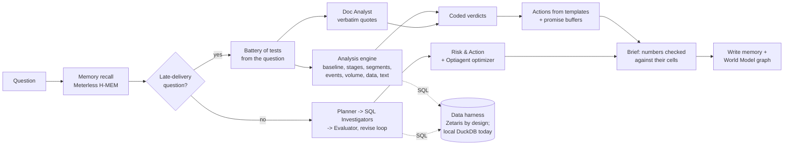

# WhyChain

**A team of AI agents that explains *why* a supply chain problem is happening, proves it with evidence from every system the company runs, and prescribes fixes that are *mathematically proven* to be the cheapest, ready for a manager to approve.**

Open Agent Hackathon 2026 · Track 2: *The Agent That Can Explain Why*

---

## The problem

**On real data.** In March 2018, 19.0% of orders on Olist, a Brazilian marketplace, arrived after the promised date, against about 4–6% in a normal month. The order system shows that it happened, but not why. The evidence is spread across order timestamps, seller hand-over records, customer reviews and the news of the time.

What the raw data shows, checked independently with SQL (not by the agents):
- **Transit:** carrier transit was about 13 days in February–March 2018, against about 8.5 in a normal month. Hand-over by sellers did not slow.
- **Rio de Janeiro:** worst hit. Transit doubled (9.7 → 20.7 days) and late deliveries rose from 6% to 34%, against 16.8% in the rest of Brazil.
- **The 12–13 March Correios strike:** lateness was already high before it.

What the agents concluded in the four saved runs of this question since the baseline fix, before the latest fixes:
- **Every run:** carrier transit is the main cause (50–85% of the jump); seller hand-over, order volume and mix, and data errors are ruled out.
- **Inconsistent:** every run *also* confirmed "the Correios strike / Rio disruption" as a partial cause (12–40%), and one headline put the strike first. The Rio part is supported by the data; the strike part is not. The planner bundled both into one hypothesis, and the Evaluator confirmed it as a whole.
- **The first run of all** (before the baseline fix) blamed tighter delivery promises. That was wrong: its Jan–Feb baseline was itself abnormal.

These runs used a timestamp definition of "late" in some steps (21.4%) and calendar dates in others (19.0%). There is now one definition: calendar dates, because the promised date has no time of day. The Evaluator now judges bundled hypotheses part by part and rejects events that start after their effect. New runs and their results are in "Results"; what is still weak is in "Known limitations".

**In a simulated company,** where the agents can also act on stock: a planner sees that 26 of 32 Pune orders due next week are backordered. The answer to "why?" is spread across five systems and three inboxes:

- the **ERP** shows the backorders;
- the **warehouse export** shows the Pune DC running dry while Mumbai has surplus;
- the **procurement export** shows the supplier's revised ETA;
- the supplier's **email to procurement** explains the delay (a Chennai port strike);
- the **contract** says the strike is force majeure, so no penalty can be recovered;
- the key **customer's contract** says every late day costs 1.5% of order value.

A good analyst needs half a day to stitch that together. WhyChain does it in minutes, and shows its working.

## How it works

WhyChain splits the work between **code that computes** and **agents that plan, read and write**. Numbers and verdicts come from code; language models never produce a number that reaches the brief.

**Questions about late deliveries** (the real Olist data, and lateness questions on the simulated company) run on the **analysis engine** (`whychain/analysis/`):

1. **One federated query** pulls order-level facts through the data harness. That's one row per order: purchase, hand-over to the carrier, delivery, promised date, place, seller, carrier. "Late" has one definition: delivered on a later calendar date than promised.
2. **The question becomes a fixed battery of tests** (`battery.py`). The period, places and named events are read from the question with plain rules. The same kind of question always gets the same tests:
   - **the symptom** against a *normal* baseline: the months (or weeks) before, minus any that were themselves abnormal;
   - **each delivery stage** (seller hand-over, carrier transit, the promise): counterfactual late rates where a stage takes its baseline distribution, matched like with like by area. Exact **Shapley values** split the rise, so the shares add up;
   - **where it sits**: a shift-share split of the rise by area, seller state or carrier, separating "it got worse there" from "more orders came from there";
   - **volume**: orders per day against the four weeks before (business growth is not a surge);
   - **dated events** in or near the period: weekly transit and lateness, by the week parcels were handed to the carrier, against the **prior trend**. An event counts only if the change starts with it, and for a regional event, only if it is larger in that region;
   - **data quality and definitions**, and **what customers wrote** (review mentions per thousand orders);
   - for regional questions, a second comparison with **places at a similar distance** (similar promised times), to separate distance from everything else.
3. **Coded verdicts.** A stage is a cause if it explains at least 10% of the rise. An event is a cause only if the effect starts with it. Volume counts only if orders rose 25% or more and the chain slowed with it. The thresholds are in the code and the brief.
4. **Agents** around the engine:
   - the **Document Analyst** reads the written record and must quote it verbatim. Documents are context, never a cause: dated events are judged by the event test;
   - **actions** come from templates per confirmed cause, sized with computed tables (e.g. the promise buffer each state needs);
   - a model writes only the brief's short answer, from the computed facts. Every number in the brief is checked against its cells and marked "(unverified)" if it isn't there.

A late-delivery investigation takes about a minute and about 5 model calls, and gives the same numbers on every run.

**Other questions** (stock-outs, backlogs, orders at risk next week) use the **agent loop**:
- the Data Scout maps and join-tests the sources;
- the Planner sets competing hypotheses;
- Data Investigators write SQL;
- the Evaluator re-runs every cited query and challenges the reasoning, sending gaps back for another round;
- the Risk & Action agent calls the **Optiagent optimizer** for stock transfers, with a duality certificate proving no cheaper plan exists;
- the **Action Executor** prepares transfer orders, cancellation lists and draft emails after a manager approves.

The same numbers check applies to findings, actions and the brief.

Both paths write confirmed and ruled-out causes, with their provenance, to **Meterless H-MEM**, and cause-effect links to the **Meterless World Model**.



## Prescriptive layer: Optiagent (declared pre-existing component)

WhyChain doesn't estimate the fix by hand. It reuses the author's earlier project **[Optiagent](https://github.com/Dakshhhhh-ops/Optiagent)** (MIT, pinned to commit `f0b61d5`). Optiagent is a verified-optimization engine whose rule is that *the LLM never produces the numbers*. `whychain/optimize.py` was written for WhyChain (before the build window, see "Pre-existing work"): it turns an agent's scope into a transportation problem built entirely from the data. The optimizer applies only to the simulated dataset, which has stock, lanes and freight costs; the real Olist data has no cost data, so its actions carry no computed costs (see "Known limitations").

| Part of the model | Where it comes from |
|---|---|
| Destinations | Backordered units per DC and SKU, due within the deadline (`erp.order_lines` + `erp.sales_orders`) |
| Sources | Spare stock per DC and SKU = on hand − allocated − policy cover (`wms.inventory_snapshots`, `wms.reorder_policy`) |
| Truck routes | Lane cost per unit and transit days (`wms.transfer_lanes`). Lanes too slow for the deadline are left out. |
| Air routes | Supplier air-freight surcharge and lead time (`procurement.expedite_options`) |
| Can't arrive in time | A unit with no route that meets the deadline costs its list price (lost sale), so the plan reports it instead of hiding it |

Optiagent builds the LP, solves it (OR-Tools GLOP), re-checks the plan against the original data and attaches a **duality certificate**. If the first solver's dual prices don't close the proof (it happens on degenerate problems), WhyChain re-runs Optiagent's own certificate with the second solver's (HiGHS) prices. If neither closes it, the plan is withheld rather than shown unproven. Lanes that would carry less than 15% of a truck are dropped and the problem is re-solved, because an LP doesn't model fixed truck costs. The Action Executor's transfer order *is* this proven plan, row for row.

## Sponsor technology: designed role and actual status

This table separates what the code is built to do from what has actually run. Every saved run so far used the **local DuckDB harness** and **NVIDIA NIM** only.

| Sponsor | Designed role | Status today |
|---|---|---|
| **Zetaris** | The single path from agents to data. Sources are registered once (`scripts/register_zetaris.py --dataset olist`), and agents write federated Spark SQL across them. | **Not yet connected.** The REST client in `whychain/harness/zetaris.py` has never talked to a live instance, and its response parser is a best guess at the format. Until it is connected, agents query the same table names through the local DuckDB harness (`WHYCHAIN_HARNESS=local`), which the UI labels "local-duckdb". |
| **Meterless** | H-MEM memory with provenance and the World Model cause graph, via `meterless_bridge/`, which runs the reference engines unmodified. Nightshift would serve the Document Analyst's model locally. | **H-MEM and World Model: used in every run.** H-MEM's reference embedder is a hash-based mock, so similarity recall is weak; WhyChain filters recalled findings itself (see "Known limitations"). **Nightshift: not installed.** The Document Analyst currently runs on NVIDIA's cloud, so documents *are* sent to NIM. |
| **NVIDIA** | NIM serves **Nemotron 3.5 Super** (`nvidia/nemotron-3.5-super-vl-120b-a12b`). Reasoning ("thinking") is on for the Planner and Evaluator, and off, in JSON mode, for the other agents. **Nemotron 3 Ultra** (`nvidia/nemotron-3-ultra-550b-a55b`) is the backup model. | **Used in every run** (cloud NIM). Local GPU use via Nightshift is not set up. |
| **xAI Grok** | Optional first choice for the reasoning roles. | **Not configured;** no run has used it. |

Every model call goes through one OpenAI-compatible client with role-based fallback. Providers that aren't configured are skipped, so **with today's configuration every chain runs entirely on NVIDIA's NIM endpoint**: Nemotron 3.5 Super, then a different model, Nemotron 3 Ultra. That covers one model being overloaded, which is the usual NIM failure, but not an outage of the NIM endpoint itself. Grok or Nightshift would make the chain independent.

| Role | Used by | Order (configured today in bold) |
|---|---|---|
| `reason` | Planner, Evaluator | Grok → **Nemotron 3.5 (thinking)** → **Nemotron 3 Ultra** → **Nemotron 3.5** → Nightshift |
| `work` | Data Scout, Data Investigators, Risk & Action, Reporter, Action Executor | **Nemotron 3.5** → **Nemotron 3 Ultra** → Grok → **Nemotron 3.5 (thinking)** → Nightshift |
| `local` | Document Analyst | Nightshift → **Nemotron 3.5** → **Nemotron 3 Ultra** → Ollama |

Transient errors (5xx, rate limits, timeouts) are retried with back-off: twice when another provider follows, four times on the last one. The trace records every retry and fallback.

## Setup (clean machine)

Needs Python 3.11+, Node 20+, Docker.

```bash
# 1. Python environment
uv venv && uv pip install -e ".[dev]"          # or: python -m venv .venv && pip install -e ".[dev]"

# 2. Config
cp .env.example .env                             # then fill in keys (see comments in the file)

# 3. The data: order systems in Postgres, other systems as files
docker compose up -d
python -m datagen.olist                          # real Olist data: downloads the CSVs, writes data/olist/generated/, loads Postgres
python -m datagen.generate                       # simulated company: writes data/generated/
python -m datagen.load_postgres

# 4. Meterless engines bridge (separate terminal)
cd meterless_bridge && npm install && npm start  # http://localhost:8787

# 5. Zetaris: register the sources, then check them
python scripts/register_zetaris.py               # prints the SQL; --apply runs it via REST

# 6. Check everything
python -m whychain.doctor
```

With `WHYCHAIN_HARNESS=local`, the same sources and table names are served by DuckDB (ERP read live from Postgres). Agents write the same Spark SQL either way; it's translated with sqlglot. This exists for offline development and as a fallback if Zetaris is unreachable. **Every run so far has used it**, because Zetaris is not yet connected. The UI always shows which harness answered.

## Usage

```bash
# Web app: build the frontend once, then serve API + UI together
cd frontend && npm install && npm run build && cd ..
python -m whychain.api                           # http://localhost:8000

# Frontend development with hot reload (proxies /api to :8000)
cd frontend && npm run dev                       # http://localhost:5173

python -m whychain.cli "Why did late deliveries jump to 21% for orders placed in March 2018?"
python -m whychain.cli --dataset kaveri "Why have deliveries to Nashik been late since September?"
python -m evals.run_evals --dataset olist        # score the real-data cases (or --dataset kaveri, or all)
python -m pytest -q tests                        # wiring test (no API keys needed)
```

### The app

| Screen | What it shows |
|---|---|
| **Control tower** | On real data: a monthly chart of orders and late deliveries, with **verified external events** marked on it (hover one to read it, with links to its sources), KPI cards, and **incidents found in the data** by plain SQL rules (late-delivery spikes, missed seller hand-overs, review-score dips, reviews mentioning strikes, chronically late states). Each incident has an **Investigate why** button. On the simulated company: live KPIs, a **Needs attention** list (lanes whose on-time rate fell, backordered DCs, late suppliers, disrupted ports) and a supply network map coloured by live status. |
| **Investigation (live)** | Agents stream their work as it happens (Server-Sent Events). A stage tracker runs Recall → Map data → Plan → Investigate → Challenge → Act → Report. The hypothesis board updates as findings and verdicts arrive, including the Evaluator's send-backs, and the activity feed shows every query, document read, re-verification and escalation. |
| **Brief** | The answer, with every number citing clickable evidence; recommended actions with cost and approve/reject (decisions are written to Meterless memory); risks; lessons saved. Export to Markdown or print to PDF. |
| **Deliverables** | After approval, the Action Executor's output appears on the action card: transfer orders, cancellation lists and draft emails, each downloadable. |
| **Regions** (real data) | A tile map of Brazil's 27 states. It shows how much each state's late-delivery rate rose in the month the question is about, against a normal baseline (the six months before, leaving out months that were abnormal nationally), and outlines the states named in the confirmed causes. Hover a state for its late rate and carrier transit time. |
| **Network** (simulated company) | The supply network with the confirmed cause's path lit up, e.g. Voltix → Chennai port → Pune DC. |
| **Evidence** | Every SQL result (query, rows, re-verification badge) and every document quote (verified word for word). |
| **Memory & graph** | What was recalled from earlier runs, the cause graph in the Meterless World Model, and the data map's verified joins. |
| **Trace** | Every event, filterable by agent, downloadable as JSONL. Any finished run can be replayed. |
| **Memory** | Everything WhyChain has learned across runs, by tier (Meterless H-MEM). |
| **Data sources** | The six federated sources, their tables and columns, and the joins the Data Scout verified. |

Every run writes `runs/<run_id>/`:
- `trace.jsonl`: every agent step, SQL query, model call, fallback, verdict and escalation.
- `result.json`: plan, findings, evidence, verdicts and actions.
- `brief.md`: the action brief.

## The data

WhyChain ships with two datasets. The sidebar switches between them; the agents, prompts and UI are the same for both.

### 1. Olist: real Brazilian e-commerce data (default)

The [Brazilian E-Commerce Public Dataset by Olist](https://www.kaggle.com/datasets/olistbr/brazilian-ecommerce) (CC BY-NC-SA 4.0): 99,441 real, anonymised orders placed from 2016 to 2018. `python -m datagen.olist` downloads the original CSVs and splits them into the systems a marketplace would actually run, so the agents have to federate:

| Source | System | Tables |
|---|---|---|
| `oms` | Order management (Postgres) | `orders` (purchase, approval, carrier hand-over, delivery and promised dates), `customers` |
| `sellers` | Seller platform (CSV) | `order_items` (with each seller's shipping deadline), `sellers`, `products` |
| `payments` | Payment gateway (JSON lines) | `order_payments` |
| `feedback` | Customer reviews (JSON lines) | `reviews`: 100,000 real reviews, in Portuguese |
| `signals` | External events (JSON lines) | `events`: 16 verified events, 2017–2018 |
| `docs` | News briefs | `documents`: 13 briefs on those events |

Nothing is planted. The events (Correios strikes, the 2018 truckers' strike, Carnival, Black Friday, Rio de Janeiro's federal intervention and cargo-theft record, Correios price and policy changes) were researched for this project from public sources, mainly Agência Brasil and the official legal texts. Every event and brief lists its source URLs, and the control tower links to them. They are in `datagen/olist_events.json`, with summaries paraphrased rather than copied. The dataset is not redistributed in this repository; the script downloads it.

The control tower finds incidents with plain rules on the real data: months whose late-delivery rate is far above the median, months where sellers missed hand-over deadlines, falls in review scores, reviews that mention strikes, and states with chronic delays. Verified events are marked on the monthly chart.

### 2. Kaveri: a simulated distributor, for the full prescriptive loop

Olist has no warehouse stock to move, so the optimizer and stock-transfer deliverables are shown on a simulated company. It is fictional: **Kaveri Consumer Electronics Distribution**, with 3 DCs (Mumbai, Pune, Chennai), 11 suppliers, 74 SKUs and 52 retail customers. `datagen/generate.py` simulates 90 days of the business day by day: orders, ship-complete fulfilment, reorder-point replenishment, supplier lead times and carrier transit. Problems are planted as **causes**, not answers:

| Case | Planted cause | Red herring |
|---|---|---|
| A. Pune orders at risk | Chennai port strike strands Voltix (S-14) pre-build POs; Mumbai holds surplus | IMD rain alert in Pune |
| B. Nashik deliveries late | SwiftCargo's v2 contract moved the lane to a Tue/Fri consolidated milk-run | stock-outs |
| C. Mumbai earbuds stock-out | Marketing's DIWALI26 promo was never shared with planning; reorder points stale | port strike |
| D. Chennai backlog jump | EDI connector v3.2 retry bug duplicates orders (same `external_ref`) | thunderstorms |
| E. On-time rate drop | Several of the above at once | weather |

`evals/cases.yaml` holds the ground truth. The agents never see it.

## Results

Run `python -m evals.run_evals` (or `--dataset olist|kaveri`) to regenerate `evals/results.md`. A case passes "root cause found" when the expected terms appear, as whole words, in a cause the Evaluator confirmed or in the headline. Keyword scoring is crude; read the briefs too.

<!-- RESULTS -->
**Status on 22 Oct, 16:00 IST: no full evaluation of the current version has finished yet.** What exists so far:

- **First real-data pass (14:00 IST, older version):** 2 of 3 Olist development cases passed. The truckers' strike case failed: the agents said "no measurable delay", but parcels handed to the carrier in the strike week took 10.5 days against about 8, and 15.5% were late against about 4%.
- **Kaveri (simulated) runs at 14:48–15:20 IST:** not a valid measurement. Two eval scripts ran at once by mistake. NVIDIA rate limits (429) crashed three runs within seconds and cut the others short; one run's planner also produced no usable tasks. These failures led to the machine-wide call limit, the longer rate-limit back-off, provider cooldowns, the per-run time limit and the empty-plan fallback.
- **March 2018 (O1) across runs:** carrier transit was always the main cause. The strike was confirmed as a partial cause in some runs and rejected in others, which the scorer now counts as a failure.

Results for the current version, including repeated runs of the same questions and the "Models used" column, will be added here when they finish. Until then, treat the numbers above as development notes, not results.

## Reliability

| Safeguard | What it prevents |
|---|---|
| Read-only SQL guard (one `SELECT` / `WITH` / `SHOW` / `DESCRIBE`) | Agents changing data |
| SQL self-repair loop | Failed queries stopping a task |
| Evidence re-execution | Cited results that aren't the real output of their query (it does **not** check reasoning) |
| Numbers check (`whychain/grounding.py`) | Numbers no cited cell supports. Agents point each key number at an exact cell (result, column, row), and code checks that cell. Arithmetic is allowed only when the wording implies it ("from A to B", "X of Y") and only between numbers of the same unit in that sentence. A finding with more than a third of its numbers unsupported cannot be confirmed. Applied to findings, to action figures (which must equal a cell; others are removed and the action escalated) and to every line of the brief (unsupported numbers are marked "(unverified)" in the text). On a probe of 1,000 fabricated numbers, 3% pass (the first version passed 93%); see `tests/test_grounding_probe.py`. |
| Question-similarity filter on memory | Findings from an unrelated investigation being reused |
| Verbatim quote verification | Invented quotes |
| Citation filter | Citations to evidence that doesn't exist |
| Join tests | Bad joins in the data map |
| Model fallback chain | One model failing the whole run (today both models sit on the same NVIDIA endpoint, so not an NVIDIA outage) |
| Local harness fallback | Zetaris being unreachable during a demo |
| Bounded rounds (`WHYCHAIN_MAX_ROUNDS`) | Endless revise loops |
| Deterministic escalation thresholds | Expensive actions going ahead without a human |

## Known limitations

| Limitation | Where it stands |
|---|---|
| Much of the project was built before the build window, and the first commits import it all at once. | Disclosed in full under "Pre-existing work". The organizers are being asked whether Track 2 accepts this or whether it belongs in the Wildcard track. |
| Zetaris, Nightshift and Grok have never run. | All runs used the local DuckDB harness and cloud NVIDIA NIM (see the sponsor table). Model fallback stays on one NVIDIA endpoint until Grok or Nightshift is configured. |
| Results vary from run to run. | Language models at temperature 0.2 do not give identical answers: the strike verdict for March 2018 has flipped between runs. Repeated runs are planned but not yet reported (see "Results"). |
| Reasoning errors can still get through. | Late-delivery questions: the tests are built to avoid the common traps (normal baselines, event tests by exposure week against the prior trend, counterfactual attribution), and verdicts are coded. Other questions (the agent loop): these are rules in the Evaluator's prompt, not code. In both paths the numbers check proves a number came from the data, not that the argument is right. |
| The engine's choices are judgement calls. | The 10% cause threshold, the 1.5x "abnormal month" rule, the event thresholds (1 day or 10% of transit, 5 points of lateness) and like-with-like matching by area were chosen by the author. They are fixed and tested (`tests/test_analysis.py`), but not validated against outside data. |
| Attribution has limits. | Stage counterfactuals swap one stage's distribution at a time within an area, and Shapley values split interactions evenly. When a segment differs from its reference in many ways at once (e.g. distance), shares can exceed 100% with an offsetting negative share; the brief reports both. |
| No cost data on the real dataset. | Olist actions show "not computed" for cost. Only the simulated dataset has computed (proven-optimal) costs. |
| Weak memory recall. | H-MEM's reference embedder is a hash mock, and the bridge's recall threshold is 0.15. Findings are reused only when they come from a similar question (word overlap ≥ 0.4); memories are hints, never evidence. |
| Tuning on the test cases. | The weekly-exposure rule was written after the truckers'-strike case failed, so O1–O3 are development cases. H1–H3 are held out: added after the last prompt change, with ground truth computed with SQL before any agent ran them. All ground truth was written by the author (the Kaveri causes were also planted by the author), so none of it is independent. |
| Crude scoring. | Eval terms match at word boundaries; red herrings are judged on confirmed hypotheses and the headline. Keyword scoring still can't judge an argument; read the briefs. |

## Repository layout

```
whychain/          agents, graph (LangGraph), harness (Zetaris + local), LLM client, memory, trace, CLI
  analysis/        deterministic engine: fact model, tests (baseline, stages, segments, events, volume, data, text),
                   question -> battery of tests -> findings with coded verdicts
  grounding.py     numbers check: every number must trace to a cited cell
  slots.py         machine-wide cap on concurrent model calls
  agents/          prompts.py, executor.py (act-observe loop), nodes.py (each agent)
  api.py           FastAPI server: runs, live event stream (SSE), decisions, overview, memory, sources
  overview.py      control-tower KPIs, problem detection rules, supply network
  optimize.py      prescriptive layer: data → transportation LP → Optiagent (proven-optimal plan)
frontend/          React + TypeScript + Tailwind web app (Vite)
datagen/           company simulator, documents, Postgres loader
evals/             ground-truth cases and scorer
meterless_bridge/  Node service exposing Meterless H-MEM + World Model engines over HTTP
scripts/           Zetaris source registration
tests/             end-to-end wiring test with a scripted model
```

## Pre-existing work (built before the build window)

The build window opened on **22 Oct 2026 at 05:30 IST**. Much of this project was written before that, between **21 Oct 23:04 IST and 22 Oct about 03:05 IST**. No work happened between 03:05 and 13:25 IST (the laptop was asleep). Everything from **22 Oct 13:25 IST** onward is in-window.

The repository was only created at 13:37 IST. So the first commits (`9b47209` to `1845287`, all at 13:44 IST) import the pre-window code together with the first in-window changes. Every later commit is in-window work.

**Third-party and earlier components**
- `optiagent-core` (installed from `github.com/Dakshhhhh-ops/Optiagent`, commit `f0b61d5`, MIT): the author's earlier verified-optimization engine (LP builder, solver, plan checks, duality certificate, sensitivity analysis). Built before the hackathon and used unmodified as a library.
- `meterless_bridge/engines/`: Meterless H-MEM and World Model reference engines, copied unmodified from `Meterless/Meterless` @ `1742dec` (Apache-2.0, LICENSE files included).
- Open-source libraries listed in `pyproject.toml`, `frontend/package.json` and `meterless_bridge/package.json`.
- The Olist dataset is third-party public data (CC BY-NC-SA 4.0), downloaded by `datagen/olist.py` and not included in the repository.

**Written before the window (21 Oct 23:04 – 22 Oct 03:05 IST)**
- Data:
  - the Kaveri simulator, its documents and Postgres loader;
  - the Olist loader (`datagen/olist.py`);
  - the 16 researched external events and 13 news briefs (`datagen/olist_events.json`).
- Harness: the Zetaris REST client (never yet run against a live instance) and the local DuckDB harness with sqlglot translation.
- The full agent graph: Memory, Data Scout, Planner, Investigators, Document Analyst, Evaluator with revise loop, Risk & Action, Reporter, and the Action Executor.
- The LLM client: NVIDIA NIM / Nemotron, role-based fallback chains and retries.
- The Optiagent integration (`whychain/optimize.py`, the `optimize` action).
- The Meterless bridge service (`meterless_bridge/server.ts`).
- The FastAPI server with live event streaming.
- The React app: control tower, investigation view, brief, evidence, memory, data sources, dataset switch, and the monthly chart with event markers.
- Tooling: the Kaveri eval cases and scorer, the wiring tests, `doctor`, the CLI and `start.cmd`.
- First versions of this README and `PLAN.md`.

**Written in the window (from 22 Oct 13:25 IST)**: see `git log` from `dd939d3` onward. The changes bundled into the 13:44 commits:
- the README's real-data sections;
- per-dataset Zetaris registration;
- the `--dataset` option for the CLI, `investigate()` and evals;
- the three Olist eval cases.

Later commits:
- the Reporter rewrite;
- the JSON fallback for reasoning models;
- the Regions view;
- incomplete-run marking;
- the weekly-exposure rule for dated events;
- everything addressing the review in "Known limitations".
